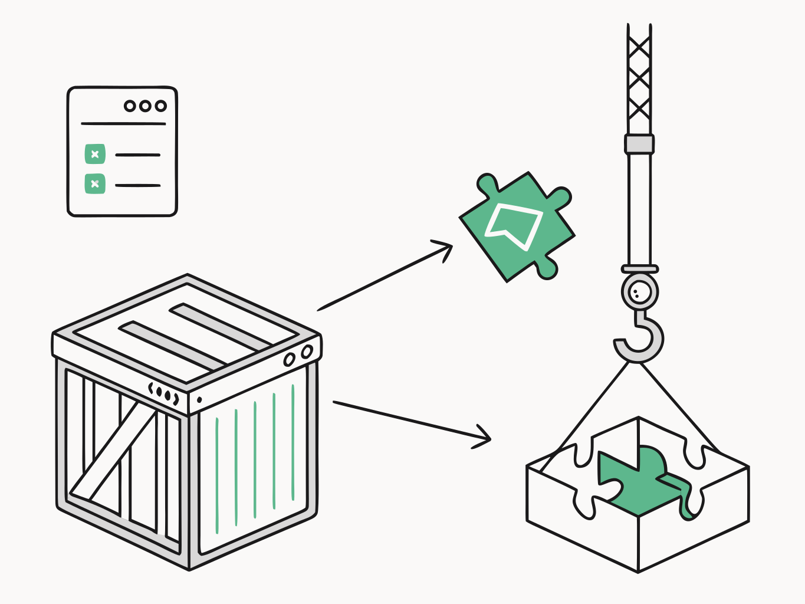
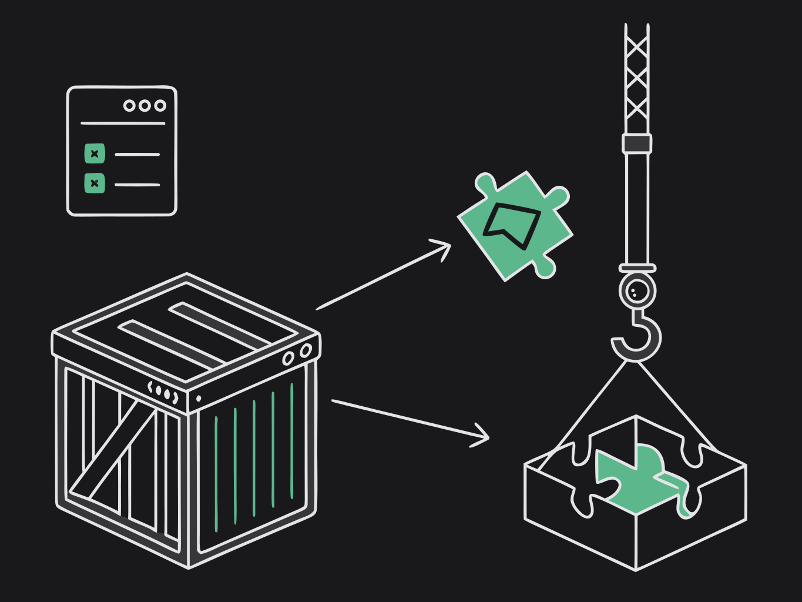

{class="dark:hidden"}
{class="hidden dark:block"}

## Quick install (recommended)

Use the Tauri CLI — it adds the Rust crate and the JS package in one step. Works with any package manager, and with `cargo tauri` too:

```bash
# npm
npm run tauri add tauri-plugin-widgets

# pnpm
pnpm tauri add tauri-plugin-widgets

# yarn
yarn tauri add tauri-plugin-widgets

# bun
bun tauri add tauri-plugin-widgets

# cargo (no Node script required)
cargo tauri add tauri-plugin-widgets
```

Then finish [Register the plugin](#register-the-plugin), [Permissions](#permissions), and (on Apple hosts) [Plugin config](#apple-hosts-plugin-config) if the CLI did not wire them for your project layout.

Optional Cargo features: [Cargo features](/api/cargo-features).

## Manual install

### Cargo

```toml
# src-tauri/Cargo.toml
[dependencies]
tauri-plugin-widgets = "0.8"
```

Or:

```bash
cd src-tauri && cargo add tauri-plugin-widgets
```

### JavaScript package

```bash
pnpm add tauri-plugin-widgets-api
# npm i tauri-plugin-widgets-api
# yarn add tauri-plugin-widgets-api
# bun add tauri-plugin-widgets-api
```

## Register the plugin

```rust
#[cfg_attr(mobile, tauri::mobile_entry_point)]
pub fn run() {
    tauri::Builder::default()
        .plugin(tauri_plugin_widgets::init())
        .run(tauri::generate_context!())
        .expect("error while running tauri application");
}
```

## Plugin config

None needed. Defaults:

| Setting | Default |
| --- | --- |
| `plugins.widgets.appGroup` | `group.<identifier>` from `tauri.conf.json` |
| `plugins.widgets.transport` | `widgetContainer` on macOS, `appGroup` on iOS |
| JS `group` argument | the App Group above |
| JS `widgetId` argument | `"default"` (matches the Swift / Kotlin templates) |

Set `appGroup` only when the group id differs from `group.<identifier>`. iOS device widgets need a **paid** Apple Developer account (App Groups). Details: [Plugin config](/api/plugin-config) · [Transport](/guide/transport).

## Permissions

`src-tauri/capabilities/default.json` must list **every window label** that calls plugin commands — including desktop widget labels from `createWidgetWindow`:

```json
{
  "identifier": "default",
  "windows": ["main", "weather"],
  "permissions": [
    "core:default",
    "widgets:default"
  ]
}
```

Use `"*"` only if you intentionally allow all labels. Missing the widget label → the embedded renderer cannot call `getWidgetConfig` and the window stays empty.

Full list: [Permissions](/api/permissions).

## Scaffold native extensions

These copy templates into **your** app under `src-tauri/` (they do not leave files only inside `node_modules`):

```bash
npx tauri-widgets init                # every platform this project targets
npx tauri-widgets init-macos          # → src-tauri/macos-widget/ + tauri.macos.conf.json
npx tauri-widgets init-ios            # → src-tauri/ios-widget/ + extension target in gen/apple
npx tauri-widgets init-windows        # → src-tauri/windows-widget/
```

Guides: [Platform setup](/guide/setup).

Next: [First widget](/guide/first-widget) (desktop) or [Platform setup](/guide/setup).
