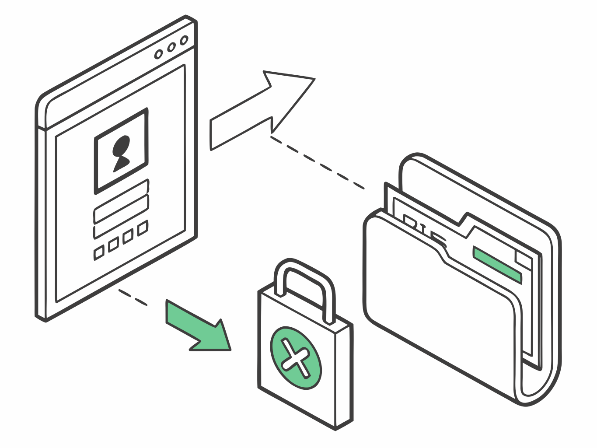
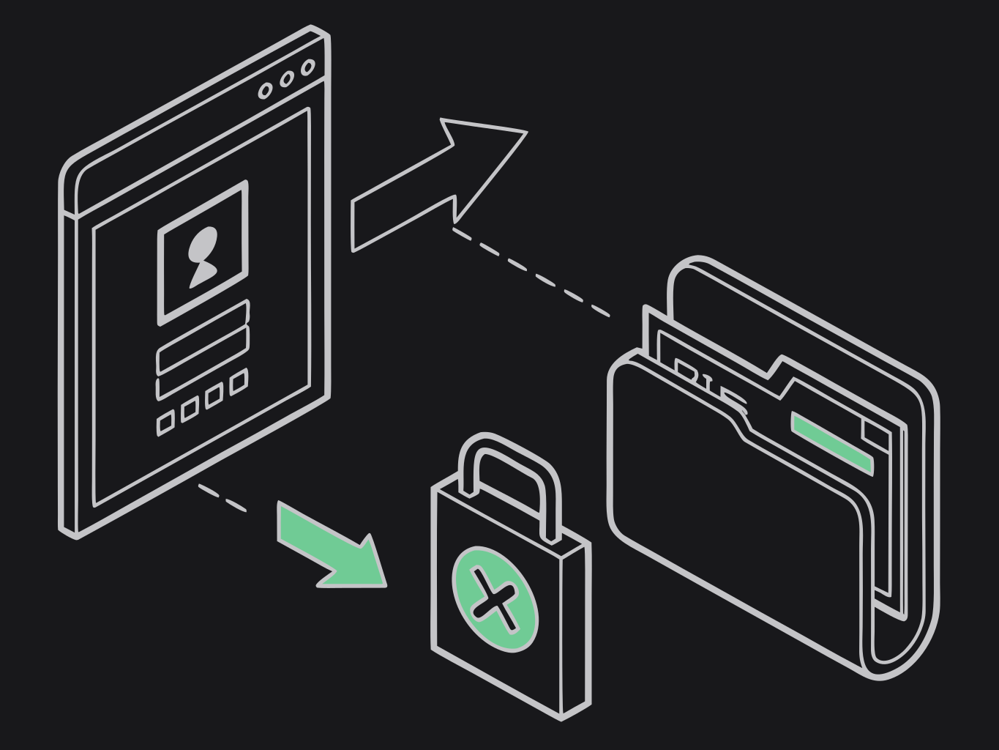

The host writes widget data through **one** transport. Leave `transport` unset and the plugin picks the one that works for a normal build:

| Platform | Default | Why |
|----------|---------|-----|
| macOS | `widgetContainer` | The widget extension is sandboxed. A Developer ID or ad-hoc build has no provisioning profile, so the extension cannot open a `group.*` container. The host (not sandboxed) writes straight into the extension's own container. |
| iOS | `appGroup` | The only channel iOS has. |
| Android, Windows, Linux | not used | |

{class="dark:hidden"}
{class="hidden dark:block"}

Set it only for a sandboxed macOS host (Mac App Store), where the App Group is backed by a provisioning profile:

```json
{
  "plugins": {
    "widgets": {
      "transport": "appGroup"
    }
  }
}
```

| `transport` | Host write path | Requirements |
|-------------|-----------------|--------------|
| `widgetContainer` | `~/Library/Containers/<appex>/Data/widget_data.json` | macOS host **not** sandboxed (Tauri default); ad-hoc or Developer ID |
| `appGroup` | `containerURL(group)/widget_data.json` | App Group authorized by a provisioning profile on app + extension (iOS, Mac App Store) |
| `userDefaults` | App Group `UserDefaults` suite | Same as `appGroup` |
| `auto` | One-shot probe, then latch | Development only — never ship this |

`extensionBundleId` defaults to `<identifier>.widgetkit` (what `init-macos` creates).

Override without editing conf: `WIDGET_TRANSPORT=widgetContainer`.

The **widget extension** still reads all channels and picks the freshest map (so it can find data wherever the host wrote). Host-side writes use only the configured driver. Render receipts feed `getWidgetDiagnostics`, not transport selection.

`setItems` skips disk I/O when the value is unchanged (no nonce bump).

## App Groups & signing (plugin consumers)

For live widgets that share data with the host you need the **same** App Group id in four places, plus a Team ID that actually owns that group.

| Place | What to set |
| --- | --- |
| [Apple Developer → Identifiers](https://developer.apple.com/account/resources/identifiers/list) | App Group + both App IDs with **App Groups** capability |
| Xcode **Signing & Capabilities** (app + widget targets) | Same group checked |
| `plugins.widgets.appGroup` in `tauri.conf.json` | Same string |
| JS `setWidgetConfig(config, group, …)` | Same string as `group` |

Swift `TauriWidgetProvider(appGroup:widgetId:)` must use that group too (CLI templates fill it).

### Register on the Developer portal

You need **Account Holder** or **Admin** on the team that signs the app (the Team ID in Xcode / `bundle.iOS.developmentTeam`).

1. **Identifiers → + → App Groups**  
   Identifier like `group.com.example.myapp` (reverse-DNS). Register.
2. **Identifiers → + → App IDs** (type App) for the **main** bundle, e.g. `com.example.myapp`  
   Enable **App Groups** → Configure → tick your group → Save.
3. Repeat for the **widget** bundle, e.g. `com.example.myapp.WidgetExtension`  
   Same App Groups tick → Save.
4. In Xcode, set **Team** on both targets, Automatic signing, and add the App Groups capability if it is not already there.

Then pin config:

```json
{
  "plugins": {
    "widgets": {
      "appGroup": "group.com.example.myapp",
      "transport": "appGroup"
    }
  },
  "bundle": {
    "iOS": {
      "developmentTeam": "YOUR_TEAM_ID"
    }
  }
}
```

iOS uses `appGroup` (the default there). macOS Developer ID and ad-hoc builds use `widgetContainer` (the default there); `appGroup` on macOS only for a sandboxed Mac App Store host ([macOS setup](/guide/setup/macos)).

### “Identifier is not available”

If the portal says *An Application Group with Identifier '…' is not available*:

- The id is **already registered on another team** (or another Apple ID). You cannot recreate it under this team.
- Either switch Xcode / `developmentTeam` to the team that owns the group, **or** register a **new** unique id (e.g. `group.com.example.myapp2`) and update conf, entitlements, Swift, and JS together.

Confirm you are editing Identifiers for the **same** team as `DEVELOPMENT_TEAM` / `bundle.iOS.developmentTeam`.

### Signing cheat sheet

| Host | Signing | `transport` |
| --- | --- | --- |
| iOS device / TestFlight | Apple Development or Distribution + Team ID | `appGroup` |
| iOS Simulator | Development / Automatic | `appGroup` (portal group still required for Automatic profiles with the entitlement) |
| macOS, Developer ID or ad-hoc (`-`) | Host not sandboxed | `widgetContainer` (default) |
| macOS, Mac App Store | Sandboxed host, provisioning profile | `appGroup` |

List identities (or use the CLI):

```bash
npx tauri-widgets signing
security find-identity -v -p codesigning
```

For CI / local env vars used by Tauri Apple builds (`APPLE_DEVELOPMENT_TEAM`, optional ASC API key), keep secrets out of git. Unset `APPLE_API_KEY` / `APPLE_API_ISSUER` / `APPLE_API_KEY_PATH` when running `tauri ios build` if you need real codesign — with those set, tauri-cli may stamp a dummy identity.

### Sanity check

```bash
npx tauri-widgets doctor
# or: pnpm tauri-widgets doctor /path/to/your-app
```

Checks conf ↔ entitlements ↔ project mentions of the App Group, and (when a built `.app` exists) ad-hoc vs Team ID mismatches. Details: [Doctor](/guide/doctor).

Platform walkthroughs: [iOS setup](/guide/setup/ios) · [macOS setup](/guide/setup/macos).
