Desktop hosts show widgets as **frameless transparent webview windows**. The JSON config is drawn by a small HTML/JS renderer shipped **inside the Rust crate** — you do **not** copy or install a separate `widget.html` for the default path.

**Windows** also supports **Widgets Board** via Adaptive Cards (see [Windows setup](/guide/setup/windows)). **Linux** pins webview windows with X11 `_NET_WM_WINDOW_TYPE_DESKTOP` when the `linux` feature is on (Wayland: optional `layer-shell`).

## How it works

1. App code calls `setWidgetConfig(config, group, widgetId)` — the host writes IR JSON into shared storage.
2. `createWidgetWindow({ label, width, height, group, widgetId, size })` opens a frameless window.
3. With **no `url`**, the plugin loads the built-in page over a custom URI scheme (`widgetview://…` on macOS/Linux, `https://widgetview.localhost/…` on Windows) and passes `group`, `widgetId`, and `size` as query params.
4. That page is the repo’s `widget.html`, compiled into the plugin via `include_bytes!` at plugin init. It calls `getWidgetConfig` / listens for updates and paints the IR with vanilla HTML/CSS/SVG.

So after `cargo add` / `tauri add`, the renderer is already there. Nothing to download from GitHub or put under `public/`.

{class="dark:hidden"}
{class="hidden dark:block"}

## Recommended: dynamic window (TypeScript)

```typescript
import { createWidgetWindow, closeWidgetWindow } from "tauri-plugin-widgets-api";

await createWidgetWindow({
  label: "weather",
  width: 280,
  height: 200,
  x: 80,
  y: 80,
  skipTaskbar: true,
  group: "group.com.example.myapp",
  widgetId: "weather",
  size: "small",
  // url omitted → built-in renderer
});

await closeWidgetWindow("weather");
```

`group` and `widgetId` are required when `url` is omitted — they tell the embedded page which config to load. `size` is optional and defaults to `"small"`.

On **macOS**, `transparent(true)` is applied only when the crate is built with feature `macos-private-api` and the host enables Tauri’s macOS private API. Without that, the window still opens (opaque chrome / background).

Full walkthrough: [First widget](/guide/first-widget).

## Window modes

All optional; omitted fields keep the old behaviour.

| Field | Values | Effect |
|---|---|---|
| `layer` | `normal` · `top` · `bottom` · `desktop` | Default: `top` with `alwaysOnTop`, else `desktop` on Linux, `normal` on macOS / Windows |
| `clickThrough` | bool | Clicks go to whatever is below |
| `focusable` | bool (default `true`) | Window can take keyboard focus |
| `allWorkspaces` | bool (default `true` for `desktop`) | Visible on every virtual desktop / Space |
| `shadow` | bool | System shadow (macOS / Windows) |
| `effects` | `vibrancy` · `mica` · `acrylic` · `blur` | Backdrop material; needs a transparent window, ignored on Linux |

What `layer` does per OS:

| Layer | macOS | Windows | Linux X11 | Linux Wayland (`layer-shell`) |
|---|---|---|---|---|
| `top` | floating level | always on top | `_NET_WM_STATE_ABOVE` | layer `Top` |
| `bottom` | below normal windows | always on bottom | `_NET_WM_STATE_BELOW` | layer `Bottom` |
| `desktop` | just above the Finder icons, stationary in Mission Control, out of the Cmd-` cycle | behind the desktop icons (WorkerW / Progman) | `_NET_WM_WINDOW_TYPE_DESKTOP` + below + sticky | layer `Background` |

## Placement and remembered positions

```typescript
await createWidgetWindow({
  label: "clock",
  width: 220,
  height: 120,
  group: "group.com.example.myapp",
  widgetId: "clock",
  layer: "desktop",
  placement: { monitor: 0, anchor: "bottom-right", offsetX: 24, offsetY: 24 },
});
```

- `placement` positions the window in the chosen monitor's **work area** (no menu bar, taskbar or panels). `monitor` is an index or a monitor name (default: primary). Offsets are logical px inward from the anchored edges and are scaled by that monitor's DPI.
- Where the user drags a window is saved per label in `{appData}/widget-windows.json` (physical px). Next time the same label opens there, as long as at least 48 px of it still lies on a connected monitor; otherwise `placement` / `x` / `y` apply. Turn it off with `rememberPosition: false`.

## Reopen widgets after autostart

The same file keeps the set of open widget windows. `closeWidgetWindow` (and the renderer's close button) removes a window from it; quitting the app does not. Opt in to reopening them:

```json
{ "plugins": { "widgets": { "restoreWindowsOnStart": true } } }
```

From Rust: `app.widget().restore_windows()`.

## Live activities: island, window or notification

By default (`"activitySurface": "island"`) live activities appear as a black pill at the top centre of the primary display, like the iPhone Dynamic Island: around the camera notch on notched Macs, under the menu bar on other Macs, at the top edge on Windows and Linux. Hover (or click) expands it. The island window is labelled `activity-_island`: allow it in your capability (`"windows": ["main", "activity-*"]`). For the rounded pill on macOS enable the plugin's `macos-private-api` feature (`app.macOSPrivateApi: true`); without it the window is opaque black with square corners. See [Live activities](/features/live-activities#desktop-island).

`"activitySurface": "window"` keeps the older small window in the top-right corner.

With Cargo feature `notify`, `"activitySurface": "notification"` shows live activities as system notifications: Linux via notify-rust (updates replace the same notification, progress as the `value` hint), Windows as a toast with an in-place progress bar. The same fallback is used when no activity window can open. macOS keeps the island.

## Rust data sources

Feed `{{data.…}}` from the host without JavaScript (like eww `defpoll` / `deflisten`):

```rust
use tauri_plugin_widgets::WidgetExt;
use std::time::Duration;

app.widget().register_poll_source("cpu", Duration::from_secs(2), || {
    serde_json::json!({ "load": read_load() })
});

let (tx, rx) = std::sync::mpsc::channel();
app.widget().register_listen_source("player", rx); // every tx.send(json) → setWidgetData
```

Registering the same widget id again replaces its source; `unregister_source(id)` stops it. Unchanged values are not rewritten. `app.widget().set_widget_data(id, &value, instance, group)` is the one-shot form.

## Custom renderer (optional)

Only set `url` if you want **your own** frontend page instead of the built-in one:

```typescript
await createWidgetWindow({
  label: "weather",
  url: "/my-widget.html", // served from your app frontend
  width: 280,
  height: 200,
});
```

Then you own loading and painting. A reference implementation ships in the npm package as `widget.html` (same file as in the crate):

```bash
# inspect / fork as a starting point — not required for the default path
cp node_modules/tauri-plugin-widgets-api/widget.html src/my-widget.html
```

Or browse it on GitHub: [`widget.html`](https://github.com/s00d/tauri-plugin-widgets/blob/main/widget.html).

## Declarative windows in `tauri.conf.json`

Prefer `createWidgetWindow` for the built-in renderer: it wires the `widgetview` URL and query params correctly.

If you declare a window in config instead, **`"/widget.html"` is not provided by the plugin** — that path only works if **you** put a file in your frontend assets (see [Custom renderer](#custom-renderer-optional)). Example of a custom-asset window:

```json
{
  "app": {
    "windows": [
      { "label": "main", "title": "My App", "width": 800, "height": 600 },
      {
        "label": "desktop-widget",
        "url": "/my-widget.html",
        "width": 300,
        "height": 150,
        "decorations": false,
        "transparent": true,
        "alwaysOnBottom": true,
        "skipTaskbar": true,
        "visible": false,
        "resizable": false
      }
    ]
  }
}
```

## When it fails

- Call `createWidgetWindow(...)` without `url`, and pass `group` / `widgetId` (`size` optional, default `small`).
- Do not expect `/widget.html` to exist unless you copied a custom page into the frontend.
- Allow the **window label** in capabilities (`"windows": ["main", "weather"]` + `widgets:default`).
- On macOS hosts, set `plugins.widgets.appGroup` (+ `transport`) or plugin init fails — even for webview-only widgets.
- On Linux, enable the `linux` feature for X11 DESKTOP pinning.
- A window keeps opening in an old spot: that is the remembered position; pass `rememberPosition: false` or delete `widget-windows.json`.
- On Windows Widgets Board, run `init-windows` into `src-tauri/windows-widget/` and verify `ac:template:*` after `setWidgetConfig`.

More symptoms: [Troubleshooting index](/guide/troubleshooting).
