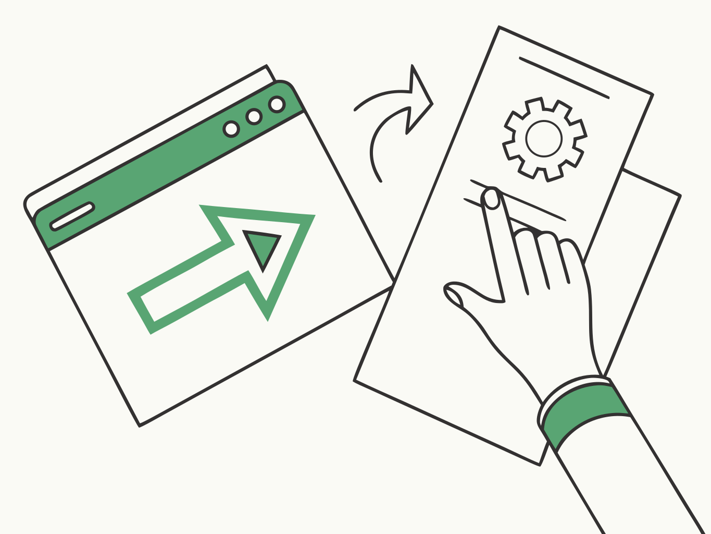
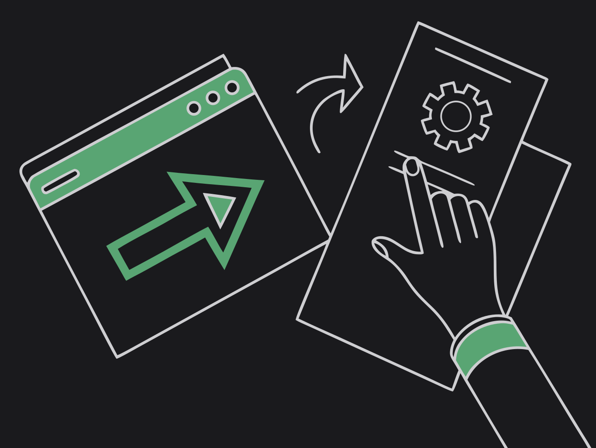

`button` and `link` elements emit `widget-action` events back to the app.

{class="dark:hidden"}
{class="hidden dark:block"}

```typescript
import { onWidgetAction } from "tauri-plugin-widgets-api";

await onWidgetAction((data) => {
  console.log("Action:", data.action, data.payload, data.widgetId, data.group);
});
```

Action payload shape: `{ action, payload?, ts, widgetId, group }`.

You can also emit from the host with `widgetAction(action, payload?)`.
