Visual index of the widget IR. Grouped pages explain siblings side by side (e.g. progress vs gauge on [Data](/elements/data)).

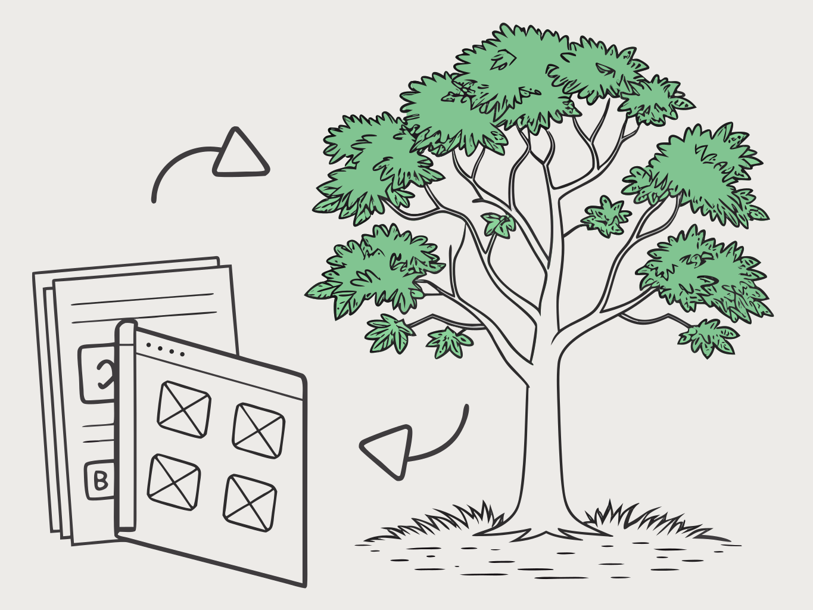{class="dark:hidden"}
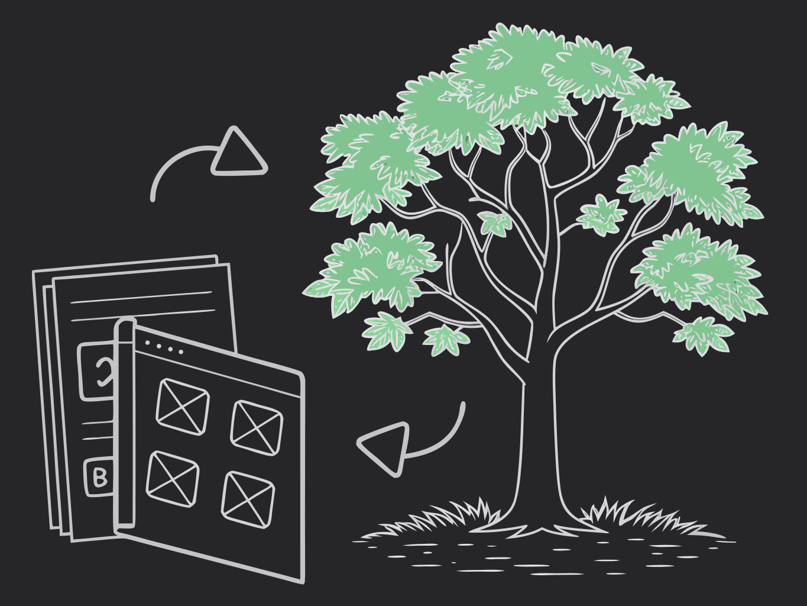{class="hidden dark:block"}

<!-- generated:elements-index — do not edit; run `pnpm docs:generate` -->

Generated from the JSON schema. Prefer the thematic pages for choosing between siblings.

| Element | Tier | Preview |
| --- | --- | --- |
| [`button`](/elements/interactive#button) | core | 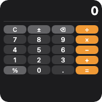 |
| [`canvas`](/elements/media#canvas) | extended | 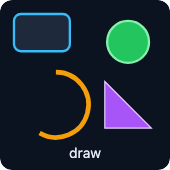 |
| [`chart`](/elements/data#chart) | extended | 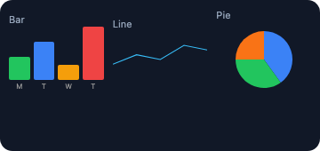 |
| [`container`](/elements/layout#container) | core | 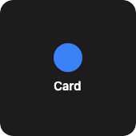 |
| [`date`](/elements/text#date) | extended | 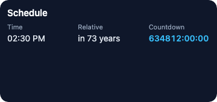 |
| [`divider`](/elements/spacing#divider) | core |  |
| [`gauge`](/elements/data#gauge) | extended | 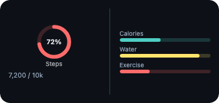 |
| [`grid`](/elements/layout#grid) | core |  |
| [`hstack`](/elements/layout#hstack) | core |  |
| [`image`](/elements/media#image) | core |  |
| [`label`](/elements/text#label) | extended | 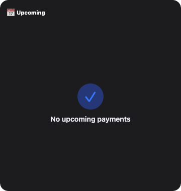 |
| [`link`](/elements/interactive#link) | core | 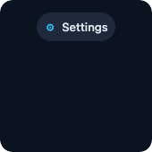 |
| [`list`](/elements/data#list) | extended | 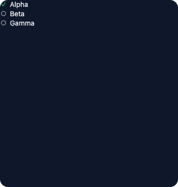 |
| [`progress`](/elements/data#progress) | core |  |
| [`repeat`](/features/dynamic-content#lists-from-data-repeat) | resolve |  |
| [`shape`](/elements/media#shape) | core |  |
| [`spacer`](/elements/spacing#spacer) | core |  |
| [`text`](/elements/text#text) | core |  |
| [`timer`](/elements/text#timer) | extended |  |
| [`toggle`](/elements/interactive#toggle) | extended | 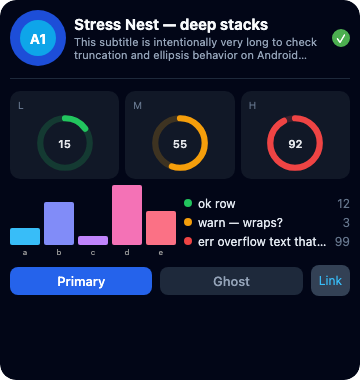 |
| [`use`](/features/dynamic-content#reusable-parts-templates-use) | resolve |  |
| [`vstack`](/elements/layout#vstack) | core |  |
| [`zstack`](/elements/layout#zstack) | core | 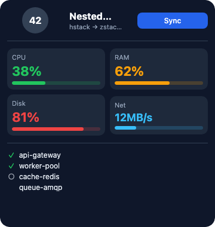 |

<!-- /generated:elements-index -->
