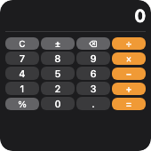
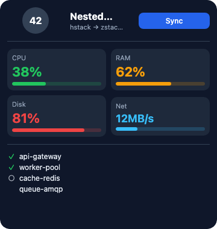
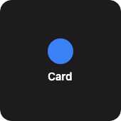

Containers that arrange children.

<!-- generated:elements-layout — do not edit; run `pnpm docs:generate` -->

## `vstack`

**Tier:** core

Vertical stack of children.



_From showcase preset — case `calculator.small`._

### Properties

| Property | Type | Default | Description |
| --- | --- | --- | --- |
| `accentable` | `boolean` | `—` | Apple tinted / accented Home Screen: draw this part in the accent color (`widgetAccentable`). Ignored elsewhere. |
| `accessibilityLabel` | `string` | `—` | Text read by screen readers instead of the visible content. |
| `alignment` | `HorizontalAlignment` | `—` | Horizontal alignment of children. |
| `aspectRatio` | `number` | `—` | Keep width / height at this ratio (`1` = square). |
| `background` | `BackgroundValue` | `—` | Solid, adaptive, or gradient background. |
| `bind` | `object` | `—` | Set fields from data with their JSON type: `{"value": "data.progress"}`. Use for numbers / booleans / arrays (`{{…}}` only fills strings). |
| `border` | `BorderConfig` | `—` | Border color and width. |
| `children` | `WidgetElement[]` | `—` | Child elements, top to bottom. |
| `clipShape` | `ClipShape` | `—` | Clip content to a shape (e.g. circle avatar from square image). |
| `cornerRadius` | `number` | `—` | Corner radius in points. |
| `flex` | `number` | `—` | Layout weight for flexible sizing inside stacks (like Android `layout_weight`). |
| `frame` | `FrameConfig` | `—` | Explicit width / height / max constraints. |
| `justify` | `Justify` | `—` | Distribution of children along the stack axis (`spaceBetween`, …). Default `start`. |
| `layoutPriority` | `number` | `—` | Who keeps its size in a crowded stack: higher first. Default `0`. |
| `margin` | `PaddingValue` | `—` | Outer spacing (number or per-edge object), outside background and border. |
| `offsetX` | `number` | `—` | Move right by points after layout (does not affect siblings). |
| `offsetY` | `number` | `—` | Move down by points after layout (does not affect siblings). |
| `opacity` | `number` | `—` | Opacity from `0` (invisible) to `1` (opaque). |
| `padding` | `PaddingValue` | `—` | Inset padding (number or per-edge object). |
| `privacySensitive` | `boolean` | `—` | Hide this content where the OS redacts private data (iOS / macOS locked screen, StandBy). Ignored where no redaction exists. |
| `rotation` | `number` | `—` | Rotate by degrees (clockwise). |
| `scale` | `number` | `—` | Scale factor (`1` = unchanged). |
| `shadow` | `ShadowConfig` | `—` | Drop shadow. |
| `spacing` | `number` | `—` | Space between children (points). |
| `transition` | `Transition` | `—` | How this element changes between timeline entries / redraws (a hint): `numeric` animates digits, `opacity` cross-fades, `slide` pushes from the bottom. Apple and desktop animate; Android and Adaptive Cards ignore it. |
| `when` | `object` | `—` | Show only when the condition holds (`{"path": "data.n", "gt": 0}`; see [`crate::resolve`]). Removed before rendering. |

### Examples

#### Minimal

```json
{
  "type": "vstack",
  "spacing": 8,
  "padding": 14,
  "cornerRadius": 16,
  "background": {
    "light": "#E8F4FD",
    "dark": "#1a1a2e"
  },
  "children": [
    {
      "type": "text",
      "content": "72°",
      "textStyle": "largeTitle",
      "fontWeight": "bold",
      "color": "label"
    },
    {
      "type": "text",
      "content": "Sunny",
      "fontSize": 14,
      "color": "secondaryLabel"
    }
  ]
}
```

#### From showcase `calculator.small` (size root)

```json
{
  "type": "vstack",
  "padding": 6,
  "spacing": 2,
  "cornerRadius": 14,
  "background": "#1c1c1e",
  "children": [
    {
      "type": "hstack",
      "spacing": 4,
      "alignment": "center",
      "children": [
        {
          "type": "text",
          "content": " ",
          "fontSize": 10,
          "color": "#f09a36",
          "alignment": "leading",
          "lineLimit": 1
        },
        {
          "type": "spacer"
        },
        {
          "type": "text",
          "content": "… +1 more",
          "fontSize": 11,
          "color": "secondaryLabel"
        }
      ]
    },
    {
      "type": "divider",
      "color": "#3a3a3c",
      "thickness": 1
    },
    {
      "type": "grid",
      "columns": 4,
      "spacing": 2,
      "rowSpacing": 2,
      "children": [
        {
          "type": "button",
          "label": "C",
          "action": "calc:C",
          "backgroundColor": "#636366",
          "color": "#fff",
          "fontSize": 10,
          "cornerRadius": 6,
          "padding": {
            "top": 1,
            "bottom": 1,
            "leading": 2,
            "trailing": 2
          }
        },
        {
          "type": "button",
          "label": "±",
          "action": "calc:+-",
          "backgroundColor": "#636366",
          "color": "#fff",
          "fontSize": 10,
          "cornerRadius": 6,
          "padding": {
            "top": 1,
            "bottom": 1,
            "leading": 2,
            "trailing": 2
          }
        },
        {
          "type": "text",
          "content": "… +18 more",
          "fontSize": 11,
          "color": "secondaryLabel"
        }
      ]
    }
  ]
}
```

#### From showcase `canvas-scale.small` (size root)

```json
{
  "type": "vstack",
  "padding": 4,
  "background": "#111",
  "alignment": "center",
  "children": [
    {
      "type": "canvas",
      "width": 60,
      "height": 60,
      "elements": [
        {
          "draw": "circle",
          "cx": 30,
          "cy": 30,
          "r": 25,
          "fill": "#1e40af",
          "stroke": "#fff",
          "strokeWidth": 2
        },
        {
          "draw": "line",
          "x1": 30,
          "y1": 30,
          "x2": 30,
          "y2": 10,
          "stroke": "#fff",
          "strokeWidth": 2
        }
      ]
    }
  ]
}
```

#### Inside a `WidgetConfig`

```json
{
  "small": {
    "type": "vstack",
    "spacing": 8,
    "padding": 14,
    "cornerRadius": 16,
    "background": {
      "light": "#E8F4FD",
      "dark": "#1a1a2e"
    },
    "children": [
      {
        "type": "text",
        "content": "72°",
        "textStyle": "largeTitle",
        "fontWeight": "bold",
        "color": "label"
      },
      {
        "type": "text",
        "content": "Sunny",
        "fontSize": 14,
        "color": "secondaryLabel"
      }
    ]
  }
}
```

## `hstack`

**Tier:** core

Horizontal stack of children.


_From showcase preset — case `calculator.small`._

### Properties

| Property | Type | Default | Description |
| --- | --- | --- | --- |
| `accentable` | `boolean` | `—` | Apple tinted / accented Home Screen: draw this part in the accent color (`widgetAccentable`). Ignored elsewhere. |
| `accessibilityLabel` | `string` | `—` | Text read by screen readers instead of the visible content. |
| `alignment` | `VerticalAlignment` | `—` | Vertical alignment of children. |
| `aspectRatio` | `number` | `—` | Keep width / height at this ratio (`1` = square). |
| `background` | `BackgroundValue` | `—` | Solid, adaptive, or gradient background. |
| `bind` | `object` | `—` | Set fields from data with their JSON type: `{"value": "data.progress"}`. Use for numbers / booleans / arrays (`{{…}}` only fills strings). |
| `border` | `BorderConfig` | `—` | Border color and width. |
| `children` | `WidgetElement[]` | `—` | Child elements, leading to trailing. |
| `clipShape` | `ClipShape` | `—` | Clip content to a shape (e.g. circle avatar from square image). |
| `cornerRadius` | `number` | `—` | Corner radius in points. |
| `flex` | `number` | `—` | Layout weight for flexible sizing inside stacks (like Android `layout_weight`). |
| `frame` | `FrameConfig` | `—` | Explicit width / height / max constraints. |
| `justify` | `Justify` | `—` | Distribution of children along the stack axis (`spaceBetween`, …). Default `start`. |
| `layoutPriority` | `number` | `—` | Who keeps its size in a crowded stack: higher first. Default `0`. |
| `margin` | `PaddingValue` | `—` | Outer spacing (number or per-edge object), outside background and border. |
| `offsetX` | `number` | `—` | Move right by points after layout (does not affect siblings). |
| `offsetY` | `number` | `—` | Move down by points after layout (does not affect siblings). |
| `opacity` | `number` | `—` | Opacity from `0` (invisible) to `1` (opaque). |
| `padding` | `PaddingValue` | `—` | Inset padding (number or per-edge object). |
| `privacySensitive` | `boolean` | `—` | Hide this content where the OS redacts private data (iOS / macOS locked screen, StandBy). Ignored where no redaction exists. |
| `rotation` | `number` | `—` | Rotate by degrees (clockwise). |
| `scale` | `number` | `—` | Scale factor (`1` = unchanged). |
| `shadow` | `ShadowConfig` | `—` | Drop shadow. |
| `spacing` | `number` | `—` | Space between children (points). |
| `transition` | `Transition` | `—` | How this element changes between timeline entries / redraws (a hint): `numeric` animates digits, `opacity` cross-fades, `slide` pushes from the bottom. Apple and desktop animate; Android and Adaptive Cards ignore it. |
| `when` | `object` | `—` | Show only when the condition holds (`{"path": "data.n", "gt": 0}`; see [`crate::resolve`]). Removed before rendering. |

### Examples

#### Minimal

```json
{
  "type": "hstack",
  "spacing": 8,
  "alignment": "center",
  "children": [
    {
      "type": "image",
      "systemName": "cloud.sun.fill",
      "size": 28,
      "color": "#ffcc00"
    },
    {
      "type": "text",
      "content": "72°",
      "fontSize": 28,
      "fontWeight": "bold",
      "color": "label"
    }
  ]
}
```

#### From showcase `calculator.small`

```json
{
  "type": "hstack",
  "spacing": 4,
  "alignment": "center",
  "children": [
    {
      "type": "text",
      "content": " ",
      "fontSize": 10,
      "color": "#f09a36",
      "alignment": "leading",
      "lineLimit": 1
    },
    {
      "type": "spacer"
    },
    {
      "type": "text",
      "content": "0",
      "fontSize": 20,
      "fontWeight": "bold",
      "color": "#ffffff",
      "alignment": "trailing",
      "lineLimit": 1
    }
  ]
}
```

#### From showcase `chart-mix.medium` (size root)

```json
{
  "type": "hstack",
  "padding": 10,
  "spacing": 10,
  "cornerRadius": 14,
  "background": "#111827",
  "alignment": "center",
  "children": [
    {
      "type": "vstack",
      "spacing": 4,
      "flex": 1,
      "children": [
        {
          "type": "text",
          "content": "Bar",
          "fontSize": 11,
          "color": "#94a3b8"
        },
        {
          "type": "chart",
          "chartType": "bar",
          "tint": "#22c55e",
          "chartData": [
            {
              "label": "M",
              "value": 3,
              "color": "#22c55e"
            },
            {
              "label": "T",
              "value": 5,
              "color": "#3b82f6"
            },
            {
              "label": "W",
              "value": 2,
              "color": "#f59e0b"
            },
            {
              "label": "T",
              "value": 7,
              "color": "#ef4444"
            }
          ]
        }
      ]
    },
    {
      "type": "vstack",
      "spacing": 4,
      "flex": 1,
      "children": [
        {
          "type": "text",
          "content": "Line",
          "fontSize": 11,
          "color": "#94a3b8"
        },
        {
          "type": "chart",
          "chartType": "line",
          "tint": "#38bdf8",
          "chartData": [
            {
              "label": "1",
              "value": 2
            },
            {
              "label": "2",
              "value": 4
            },
            {
              "label": "3",
              "value": 3
            },
            {
              "label": "4",
              "value": 6
            },
            {
              "label": "5",
              "value": 5
            }
          ]
        }
      ]
    },
    {
      "type": "vstack",
      "spacing": 4,
      "alignment": "center",
      "flex": 1,
      "children": [
        {
          "type": "text",
          "content": "Pie",
          "fontSize": 11,
          "color": "#94a3b8"
        },
        {
          "type": "chart",
          "chartType": "pie",
          "chartData": [
            {
              "label": "A",
              "value": 40,
              "color": "#3b82f6"
            },
            {
              "label": "B",
              "value": 35,
              "color": "#22c55e"
            },
            {
              "label": "C",
              "value": 25,
              "color": "#f97316"
            }
          ]
        }
      ]
    }
  ]
}
```

#### Inside a `WidgetConfig`

```json
{
  "small": {
    "type": "hstack",
    "spacing": 8,
    "alignment": "center",
    "children": [
      {
        "type": "image",
        "systemName": "cloud.sun.fill",
        "size": 28,
        "color": "#ffcc00"
      },
      {
        "type": "text",
        "content": "72°",
        "fontSize": 28,
        "fontWeight": "bold",
        "color": "label"
      }
    ]
  }
}
```

## `zstack`

**Tier:** core

Overlay stack — children layered on top of each other.



_From showcase preset — case `nested-dashboard.large`._

### Properties

| Property | Type | Default | Description |
| --- | --- | --- | --- |
| `accentable` | `boolean` | `—` | Apple tinted / accented Home Screen: draw this part in the accent color (`widgetAccentable`). Ignored elsewhere. |
| `accessibilityLabel` | `string` | `—` | Text read by screen readers instead of the visible content. |
| `alignment` | `string` | `—` | Alignment of layers within the stack (e.g. `center`, `topLeading`). |
| `aspectRatio` | `number` | `—` | Keep width / height at this ratio (`1` = square). |
| `background` | `BackgroundValue` | `—` | Solid, adaptive, or gradient background. |
| `bind` | `object` | `—` | Set fields from data with their JSON type: `{"value": "data.progress"}`. Use for numbers / booleans / arrays (`{{…}}` only fills strings). |
| `border` | `BorderConfig` | `—` | Border color and width. |
| `children` | `WidgetElement[]` | `—` | Layered children (later draw on top). |
| `clipShape` | `ClipShape` | `—` | Clip content to a shape (e.g. circle avatar from square image). |
| `cornerRadius` | `number` | `—` | Corner radius in points. |
| `flex` | `number` | `—` | Layout weight for flexible sizing inside stacks (like Android `layout_weight`). |
| `frame` | `FrameConfig` | `—` | Explicit width / height / max constraints. |
| `layoutPriority` | `number` | `—` | Who keeps its size in a crowded stack: higher first. Default `0`. |
| `margin` | `PaddingValue` | `—` | Outer spacing (number or per-edge object), outside background and border. |
| `offsetX` | `number` | `—` | Move right by points after layout (does not affect siblings). |
| `offsetY` | `number` | `—` | Move down by points after layout (does not affect siblings). |
| `opacity` | `number` | `—` | Opacity from `0` (invisible) to `1` (opaque). |
| `padding` | `PaddingValue` | `—` | Inset padding (number or per-edge object). |
| `privacySensitive` | `boolean` | `—` | Hide this content where the OS redacts private data (iOS / macOS locked screen, StandBy). Ignored where no redaction exists. |
| `rotation` | `number` | `—` | Rotate by degrees (clockwise). |
| `scale` | `number` | `—` | Scale factor (`1` = unchanged). |
| `shadow` | `ShadowConfig` | `—` | Drop shadow. |
| `transition` | `Transition` | `—` | How this element changes between timeline entries / redraws (a hint): `numeric` animates digits, `opacity` cross-fades, `slide` pushes from the bottom. Apple and desktop animate; Android and Adaptive Cards ignore it. |
| `when` | `object` | `—` | Show only when the condition holds (`{"path": "data.n", "gt": 0}`; see [`crate::resolve`]). Removed before rendering. |

### Examples

#### Minimal

```json
{
  "type": "zstack",
  "alignment": "center",
  "children": [
    {
      "type": "shape",
      "shapeType": "circle",
      "fill": "#1e293b",
      "size": 64
    },
    {
      "type": "text",
      "content": "OK",
      "fontWeight": "bold",
      "color": "#fff"
    }
  ]
}
```

#### From showcase `nested-dashboard.large`

```json
{
  "type": "zstack",
  "alignment": "center",
  "children": [
    {
      "type": "shape",
      "shapeType": "circle",
      "fill": "#334155",
      "size": 44
    },
    {
      "type": "text",
      "content": "42",
      "fontSize": 16,
      "fontWeight": "bold",
      "color": "#fff"
    }
  ]
}
```

#### From showcase `stress-align.medium` (size root)

```json
{
  "type": "zstack",
  "cornerRadius": 16,
  "background": "#0b1020",
  "children": [
    {
      "type": "shape",
      "shapeType": "rectangle",
      "fill": "#172554",
      "cornerRadius": 16
    },
    {
      "type": "vstack",
      "padding": 16,
      "spacing": 0,
      "children": [
        {
          "type": "hstack",
          "spacing": 0,
          "children": [
            {
              "type": "text",
              "content": "TL",
              "fontSize": 12,
              "fontWeight": "bold",
              "color": "#86efac",
              "frame": {
                "width": 40,
                "height": 24
              },
              "background": "#14532d",
              "cornerRadius": 4
            },
            {
              "type": "spacer"
            },
            {
              "type": "text",
              "content": "… +1 more",
              "fontSize": 11,
              "color": "secondaryLabel"
            }
          ]
        },
        {
          "type": "spacer"
        },
        {
          "type": "text",
          "content": "… +3 more",
          "fontSize": 11,
          "color": "secondaryLabel"
        }
      ]
    }
  ]
}
```

#### Inside a `WidgetConfig`

```json
{
  "small": {
    "type": "zstack",
    "alignment": "center",
    "children": [
      {
        "type": "shape",
        "shapeType": "circle",
        "fill": "#1e293b",
        "size": 64
      },
      {
        "type": "text",
        "content": "OK",
        "fontWeight": "bold",
        "color": "#fff"
      }
    ]
  }
}
```

## `grid`

**Tier:** core

Fixed-column grid of children.


_From showcase preset — case `calculator.small`._

### Properties

| Property | Type | Default | Description |
| --- | --- | --- | --- |
| `accentable` | `boolean` | `—` | Apple tinted / accented Home Screen: draw this part in the accent color (`widgetAccentable`). Ignored elsewhere. |
| `accessibilityLabel` | `string` | `—` | Text read by screen readers instead of the visible content. |
| `aspectRatio` | `number` | `—` | Keep width / height at this ratio (`1` = square). |
| `background` | `BackgroundValue` | `—` | Solid, adaptive, or gradient background. |
| `bind` | `object` | `—` | Set fields from data with their JSON type: `{"value": "data.progress"}`. Use for numbers / booleans / arrays (`{{…}}` only fills strings). |
| `border` | `BorderConfig` | `—` | Border color and width. |
| `children` | `WidgetElement[]` | `—` | Grid cells in row-major order. |
| `clipShape` | `ClipShape` | `—` | Clip content to a shape (e.g. circle avatar from square image). |
| `columns` | `integer` | `2` | Number of columns. Default `2`. |
| `cornerRadius` | `number` | `—` | Corner radius in points. |
| `flex` | `number` | `—` | Layout weight for flexible sizing inside stacks (like Android `layout_weight`). |
| `frame` | `FrameConfig` | `—` | Explicit width / height / max constraints. |
| `layoutPriority` | `number` | `—` | Who keeps its size in a crowded stack: higher first. Default `0`. |
| `margin` | `PaddingValue` | `—` | Outer spacing (number or per-edge object), outside background and border. |
| `offsetX` | `number` | `—` | Move right by points after layout (does not affect siblings). |
| `offsetY` | `number` | `—` | Move down by points after layout (does not affect siblings). |
| `opacity` | `number` | `—` | Opacity from `0` (invisible) to `1` (opaque). |
| `padding` | `PaddingValue` | `—` | Inset padding (number or per-edge object). |
| `privacySensitive` | `boolean` | `—` | Hide this content where the OS redacts private data (iOS / macOS locked screen, StandBy). Ignored where no redaction exists. |
| `rotation` | `number` | `—` | Rotate by degrees (clockwise). |
| `rowSpacing` | `number` | `—` | Row spacing (points). |
| `scale` | `number` | `—` | Scale factor (`1` = unchanged). |
| `shadow` | `ShadowConfig` | `—` | Drop shadow. |
| `spacing` | `number` | `—` | Column spacing (points). |
| `transition` | `Transition` | `—` | How this element changes between timeline entries / redraws (a hint): `numeric` animates digits, `opacity` cross-fades, `slide` pushes from the bottom. Apple and desktop animate; Android and Adaptive Cards ignore it. |
| `when` | `object` | `—` | Show only when the condition holds (`{"path": "data.n", "gt": 0}`; see [`crate::resolve`]). Removed before rendering. |

### Examples

#### Minimal

```json
{
  "type": "grid",
  "columns": 2,
  "spacing": 6,
  "children": [
    {
      "type": "button",
      "label": "7",
      "action": "digit",
      "payload": "7"
    },
    {
      "type": "button",
      "label": "8",
      "action": "digit",
      "payload": "8"
    },
    {
      "type": "button",
      "label": "9",
      "action": "digit",
      "payload": "9"
    },
    {
      "type": "button",
      "label": "÷",
      "action": "op",
      "payload": "/"
    }
  ]
}
```

#### From showcase `calculator.small`

```json
{
  "type": "grid",
  "columns": 4,
  "spacing": 2,
  "rowSpacing": 2,
  "children": [
    {
      "type": "button",
      "label": "C",
      "action": "calc:C",
      "backgroundColor": "#636366",
      "color": "#fff",
      "fontSize": 10,
      "cornerRadius": 6,
      "padding": {
        "top": 1,
        "bottom": 1,
        "leading": 2,
        "trailing": 2
      }
    },
    {
      "type": "button",
      "label": "±",
      "action": "calc:+-",
      "backgroundColor": "#636366",
      "color": "#fff",
      "fontSize": 10,
      "cornerRadius": 6,
      "padding": {
        "top": 1,
        "bottom": 1,
        "leading": 2,
        "trailing": 2
      }
    },
    {
      "type": "button",
      "label": "⌫",
      "action": "calc:BS",
      "backgroundColor": "#636366",
      "color": "#fff",
      "fontSize": 10,
      "cornerRadius": 6,
      "padding": {
        "top": 1,
        "bottom": 1,
        "leading": 2,
        "trailing": 2
      }
    },
    {
      "type": "text",
      "content": "… +17 more",
      "fontSize": 11,
      "color": "secondaryLabel"
    }
  ]
}
```

#### From showcase `flex-stroke-grid.medium`

```json
{
  "type": "grid",
  "columns": 3,
  "spacing": 8,
  "children": [
    {
      "type": "shape",
      "shapeType": "rectangle",
      "size": 36,
      "fill": "#1e293b",
      "stroke": "#22c55e",
      "strokeWidth": 2,
      "cornerRadius": 8,
      "flex": 1
    },
    {
      "type": "shape",
      "shapeType": "circle",
      "size": 36,
      "fill": "transparent",
      "stroke": "#38bdf8",
      "strokeWidth": 3,
      "flex": 1
    },
    {
      "type": "shape",
      "shapeType": "capsule",
      "size": 18,
      "fill": "#312e81",
      "stroke": "#a855f7",
      "strokeWidth": 2,
      "flex": 1
    },
    {
      "type": "text",
      "content": "… +3 more",
      "fontSize": 11,
      "color": "secondaryLabel"
    }
  ]
}
```

#### Inside a `WidgetConfig`

```json
{
  "small": {
    "type": "grid",
    "columns": 2,
    "spacing": 6,
    "children": [
      {
        "type": "button",
        "label": "7",
        "action": "digit",
        "payload": "7"
      },
      {
        "type": "button",
        "label": "8",
        "action": "digit",
        "payload": "8"
      },
      {
        "type": "button",
        "label": "9",
        "action": "digit",
        "payload": "9"
      },
      {
        "type": "button",
        "label": "÷",
        "action": "op",
        "payload": "/"
      }
    ]
  }
}
```

## `container`

**Tier:** core

Single-child wrapper for cards, badges, and overlays.



_From showcase preset — case `container-card.small`._

### Properties

| Property | Type | Default | Description |
| --- | --- | --- | --- |
| `accentable` | `boolean` | `—` | Apple tinted / accented Home Screen: draw this part in the accent color (`widgetAccentable`). Ignored elsewhere. |
| `accessibilityLabel` | `string` | `—` | Text read by screen readers instead of the visible content. |
| `aspectRatio` | `number` | `—` | Keep width / height at this ratio (`1` = square). |
| `background` | `BackgroundValue` | `—` | Solid, adaptive, or gradient background. |
| `bind` | `object` | `—` | Set fields from data with their JSON type: `{"value": "data.progress"}`. Use for numbers / booleans / arrays (`{{…}}` only fills strings). |
| `border` | `BorderConfig` | `—` | Border color and width. |
| `children` | `WidgetElement[]` | `—` | Nested content (typically one child). |
| `clipShape` | `ClipShape` | `—` | Clip content to a shape (e.g. circle avatar from square image). |
| `contentAlignment` | `string` | `—` | Content alignment inside the box (e.g. `center`, `topLeading`). |
| `cornerRadius` | `number` | `—` | Corner radius in points. |
| `flex` | `number` | `—` | Layout weight for flexible sizing inside stacks (like Android `layout_weight`). |
| `frame` | `FrameConfig` | `—` | Explicit width / height / max constraints. |
| `layoutPriority` | `number` | `—` | Who keeps its size in a crowded stack: higher first. Default `0`. |
| `margin` | `PaddingValue` | `—` | Outer spacing (number or per-edge object), outside background and border. |
| `offsetX` | `number` | `—` | Move right by points after layout (does not affect siblings). |
| `offsetY` | `number` | `—` | Move down by points after layout (does not affect siblings). |
| `opacity` | `number` | `—` | Opacity from `0` (invisible) to `1` (opaque). |
| `padding` | `PaddingValue` | `—` | Inset padding (number or per-edge object). |
| `privacySensitive` | `boolean` | `—` | Hide this content where the OS redacts private data (iOS / macOS locked screen, StandBy). Ignored where no redaction exists. |
| `rotation` | `number` | `—` | Rotate by degrees (clockwise). |
| `scale` | `number` | `—` | Scale factor (`1` = unchanged). |
| `shadow` | `ShadowConfig` | `—` | Drop shadow. |
| `transition` | `Transition` | `—` | How this element changes between timeline entries / redraws (a hint): `numeric` animates digits, `opacity` cross-fades, `slide` pushes from the bottom. Apple and desktop animate; Android and Adaptive Cards ignore it. |
| `when` | `object` | `—` | Show only when the condition holds (`{"path": "data.n", "gt": 0}`; see [`crate::resolve`]). Removed before rendering. |

### Examples

#### Minimal

```json
{
  "type": "container",
  "contentAlignment": "center",
  "padding": 12,
  "cornerRadius": 14,
  "background": "#0f172a",
  "children": [
    {
      "type": "text",
      "content": "Badge",
      "color": "#38bdf8",
      "fontWeight": "semibold"
    }
  ]
}
```

#### From showcase `container-card.small` (size root)

```json
{
  "type": "container",
  "contentAlignment": "center",
  "padding": 12,
  "cornerRadius": 16,
  "background": "#1C1C1E",
  "frame": {
    "width": 146,
    "height": 146
  },
  "children": [
    {
      "type": "vstack",
      "spacing": 8,
      "alignment": "center",
      "children": [
        {
          "type": "shape",
          "shapeType": "circle",
          "size": 36,
          "fill": "#3b82f6"
        },
        {
          "type": "text",
          "content": "Card",
          "fontSize": 15,
          "fontWeight": "semibold",
          "color": "#FFFFFF"
        }
      ]
    }
  ]
}
```

#### From showcase `v2-layout.medium`

```json
{
  "type": "container",
  "margin": 6,
  "background": "#334155",
  "cornerRadius": 4,
  "padding": 4,
  "children": [
    {
      "type": "text",
      "content": "margin 6",
      "fontSize": 13,
      "color": "#e5e7eb"
    }
  ]
}
```

#### Inside a `WidgetConfig`

```json
{
  "small": {
    "type": "container",
    "contentAlignment": "center",
    "padding": 12,
    "cornerRadius": 14,
    "background": "#0f172a",
    "children": [
      {
        "type": "text",
        "content": "Badge",
        "color": "#38bdf8",
        "fontWeight": "semibold"
      }
    ]
  }
}
```

<!-- /generated:elements-layout -->
