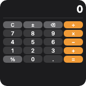
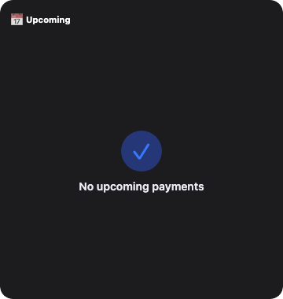
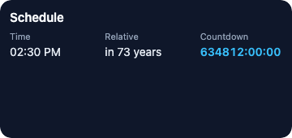

Typography and time display.

<!-- generated:elements-text — do not edit; run `pnpm docs:generate` -->

## `text`

**Tier:** core

Text label with optional semantic typography.



_From showcase preset — case `calculator.small`._

### Properties

| Property | Type | Default | Description |
| --- | --- | --- | --- |
| `accentable` | `boolean` | `—` | Apple tinted / accented Home Screen: draw this part in the accent color (`widgetAccentable`). Ignored elsewhere. |
| `accessibilityLabel` | `string` | `—` | Text read by screen readers instead of the visible content. |
| `alignment` | `TextAlignment` | `—` | Text alignment within the line. |
| `aspectRatio` | `number` | `—` | Keep width / height at this ratio (`1` = square). |
| `background` | `BackgroundValue` | `—` | Solid, adaptive, or gradient background. |
| `bind` | `object` | `—` | Set fields from data with their JSON type: `{"value": "data.progress"}`. Use for numbers / booleans / arrays (`{{…}}` only fills strings). |
| `border` | `BorderConfig` | `—` | Border color and width. |
| `clipShape` | `ClipShape` | `—` | Clip content to a shape (e.g. circle avatar from square image). |
| `color` | `ColorValue` | `—` | Text color. |
| `content` | `string` | `—` | String to display. |
| `cornerRadius` | `number` | `—` | Corner radius in points. |
| `flex` | `number` | `—` | Layout weight for flexible sizing inside stacks (like Android `layout_weight`). |
| `fontDesign` | `FontDesign` | `—` | Font design (default, monospaced, rounded, serif). |
| `fontSize` | `number` | `—` | Font size in points (overridden by `textStyle` when set). |
| `fontWeight` | `FontWeight` | `—` | Font weight. |
| `frame` | `FrameConfig` | `—` | Explicit width / height / max constraints. |
| `italic` | `boolean` | `—` | Italic. |
| `layoutPriority` | `number` | `—` | Who keeps its size in a crowded stack: higher first. Default `0`. |
| `letterSpacing` | `number` | `—` | Extra space between characters in points. |
| `lineHeight` | `number` | `—` | Line height in points. |
| `lineLimit` | `integer` | `—` | Maximum number of lines before truncation. |
| `margin` | `PaddingValue` | `—` | Outer spacing (number or per-edge object), outside background and border. |
| `minimumScaleFactor` | `number` | `—` | Allow shrinking the font down to this factor (`0.5` = half) before truncating. |
| `monospacedDigit` | `boolean` | `—` | Equal-width digits (counters, prices) without a monospaced font. |
| `offsetX` | `number` | `—` | Move right by points after layout (does not affect siblings). |
| `offsetY` | `number` | `—` | Move down by points after layout (does not affect siblings). |
| `opacity` | `number` | `—` | Opacity from `0` (invisible) to `1` (opaque). |
| `padding` | `PaddingValue` | `—` | Inset padding (number or per-edge object). |
| `privacySensitive` | `boolean` | `—` | Hide this content where the OS redacts private data (iOS / macOS locked screen, StandBy). Ignored where no redaction exists. |
| `rotation` | `number` | `—` | Rotate by degrees (clockwise). |
| `scale` | `number` | `—` | Scale factor (`1` = unchanged). |
| `shadow` | `ShadowConfig` | `—` | Drop shadow. |
| `strikethrough` | `boolean` | `—` | Strike the text through. |
| `textStyle` | `TextStyle` | `—` | Semantic text style (uses Dynamic Type on Apple, sp on Android). Overrides `fontSize` when set. |
| `transition` | `Transition` | `—` | How this element changes between timeline entries / redraws (a hint): `numeric` animates digits, `opacity` cross-fades, `slide` pushes from the bottom. Apple and desktop animate; Android and Adaptive Cards ignore it. |
| `truncationMode` | `TruncationMode` | `—` | Where text is cut when it does not fit. Default `tail`. |
| `underline` | `boolean` | `—` | Underline the text. |
| `when` | `object` | `—` | Show only when the condition holds (`{"path": "data.n", "gt": 0}`; see [`crate::resolve`]). Removed before rendering. |

### Examples

#### Minimal

```json
{
  "type": "text",
  "content": "Hello",
  "fontSize": 16,
  "fontWeight": "semibold",
  "color": {
    "light": "#0f172a",
    "dark": "#f8fafc"
  },
  "alignment": "leading",
  "lineLimit": 2
}
```

#### From showcase `calculator.small`

```json
{
  "type": "text",
  "content": " ",
  "fontSize": 10,
  "color": "#f09a36",
  "alignment": "leading",
  "lineLimit": 1
}
```

#### From showcase `chart-mix.medium`

```json
{
  "type": "text",
  "content": "Bar",
  "fontSize": 11,
  "color": "#94a3b8"
}
```

#### Inside a `WidgetConfig`

```json
{
  "small": {
    "type": "text",
    "content": "Hello",
    "fontSize": 16,
    "fontWeight": "semibold",
    "color": {
      "light": "#0f172a",
      "dark": "#f8fafc"
    },
    "alignment": "leading",
    "lineLimit": 2
  }
}
```

## `label`

**Tier:** extended

Convenience element combining an SF Symbol / icon with text.



_From showcase preset — case `upcoming-payments-empty.large`._

### Properties

| Property | Type | Default | Description |
| --- | --- | --- | --- |
| `accentable` | `boolean` | `—` | Apple tinted / accented Home Screen: draw this part in the accent color (`widgetAccentable`). Ignored elsewhere. |
| `accessibilityLabel` | `string` | `—` | Text read by screen readers instead of the visible content. |
| `aspectRatio` | `number` | `—` | Keep width / height at this ratio (`1` = square). |
| `background` | `BackgroundValue` | `—` | Solid, adaptive, or gradient background. |
| `bind` | `object` | `—` | Set fields from data with their JSON type: `{"value": "data.progress"}`. Use for numbers / booleans / arrays (`{{…}}` only fills strings). |
| `border` | `BorderConfig` | `—` | Border color and width. |
| `clipShape` | `ClipShape` | `—` | Clip content to a shape (e.g. circle avatar from square image). |
| `color` | `ColorValue` | `—` | Text color. |
| `cornerRadius` | `number` | `—` | Corner radius in points. |
| `flex` | `number` | `—` | Layout weight for flexible sizing inside stacks (like Android `layout_weight`). |
| `fontSize` | `number` | `—` | Text font size. |
| `fontWeight` | `FontWeight` | `—` | Text font weight. |
| `frame` | `FrameConfig` | `—` | Explicit width / height / max constraints. |
| `iconColor` | `ColorValue` | `—` | Icon tint color. |
| `layoutPriority` | `number` | `—` | Who keeps its size in a crowded stack: higher first. Default `0`. |
| `margin` | `PaddingValue` | `—` | Outer spacing (number or per-edge object), outside background and border. |
| `offsetX` | `number` | `—` | Move right by points after layout (does not affect siblings). |
| `offsetY` | `number` | `—` | Move down by points after layout (does not affect siblings). |
| `opacity` | `number` | `—` | Opacity from `0` (invisible) to `1` (opaque). |
| `padding` | `PaddingValue` | `—` | Inset padding (number or per-edge object). |
| `privacySensitive` | `boolean` | `—` | Hide this content where the OS redacts private data (iOS / macOS locked screen, StandBy). Ignored where no redaction exists. |
| `rotation` | `number` | `—` | Rotate by degrees (clockwise). |
| `scale` | `number` | `—` | Scale factor (`1` = unchanged). |
| `shadow` | `ShadowConfig` | `—` | Drop shadow. |
| `spacing` | `number` | `—` | Space between icon and text. |
| `systemName` | `string` | `—` | SF Symbol or platform icon name. |
| `text` | `string` | `—` | Label text. |
| `transition` | `Transition` | `—` | How this element changes between timeline entries / redraws (a hint): `numeric` animates digits, `opacity` cross-fades, `slide` pushes from the bottom. Apple and desktop animate; Android and Adaptive Cards ignore it. |
| `when` | `object` | `—` | Show only when the condition holds (`{"path": "data.n", "gt": 0}`; see [`crate::resolve`]). Removed before rendering. |

### Examples

#### Minimal

```json
{
  "type": "label",
  "text": "Inbox",
  "systemName": "envelope.fill",
  "iconColor": "#38bdf8",
  "fontSize": 15,
  "fontWeight": "medium",
  "spacing": 6
}
```

#### From showcase `upcoming-payments-empty.large`

```json
{
  "type": "label",
  "text": "Upcoming",
  "systemName": "calendar.badge.clock",
  "fontSize": 11,
  "fontWeight": "bold",
  "color": "label",
  "iconColor": "#3878FA",
  "spacing": 4
}
```

#### Inside a `WidgetConfig`

```json
{
  "small": {
    "type": "label",
    "text": "Inbox",
    "systemName": "envelope.fill",
    "iconColor": "#38bdf8",
    "fontSize": 15,
    "fontWeight": "medium",
    "spacing": 6
  }
}
```

## `date`

**Tier:** extended

Formatted date / relative time display.



_From showcase preset — case `date-timer.medium`._

### Properties

| Property | Type | Default | Description |
| --- | --- | --- | --- |
| `accentable` | `boolean` | `—` | Apple tinted / accented Home Screen: draw this part in the accent color (`widgetAccentable`). Ignored elsewhere. |
| `accessibilityLabel` | `string` | `—` | Text read by screen readers instead of the visible content. |
| `aspectRatio` | `number` | `—` | Keep width / height at this ratio (`1` = square). |
| `background` | `BackgroundValue` | `—` | Solid, adaptive, or gradient background. |
| `bind` | `object` | `—` | Set fields from data with their JSON type: `{"value": "data.progress"}`. Use for numbers / booleans / arrays (`{{…}}` only fills strings). |
| `border` | `BorderConfig` | `—` | Border color and width. |
| `clipShape` | `ClipShape` | `—` | Clip content to a shape (e.g. circle avatar from square image). |
| `color` | `ColorValue` | `—` | Text color. |
| `cornerRadius` | `number` | `—` | Corner radius in points. |
| `date` | `string` | `—` | ISO 8601 date string. |
| `dateStyle` | `DateStyle` | `—` | Display style (`time`, `date`, `relative`, `offset`, `timer`). |
| `flex` | `number` | `—` | Layout weight for flexible sizing inside stacks (like Android `layout_weight`). |
| `fontSize` | `number` | `—` | Font size in points. |
| `frame` | `FrameConfig` | `—` | Explicit width / height / max constraints. |
| `layoutPriority` | `number` | `—` | Who keeps its size in a crowded stack: higher first. Default `0`. |
| `margin` | `PaddingValue` | `—` | Outer spacing (number or per-edge object), outside background and border. |
| `offsetX` | `number` | `—` | Move right by points after layout (does not affect siblings). |
| `offsetY` | `number` | `—` | Move down by points after layout (does not affect siblings). |
| `opacity` | `number` | `—` | Opacity from `0` (invisible) to `1` (opaque). |
| `padding` | `PaddingValue` | `—` | Inset padding (number or per-edge object). |
| `privacySensitive` | `boolean` | `—` | Hide this content where the OS redacts private data (iOS / macOS locked screen, StandBy). Ignored where no redaction exists. |
| `rotation` | `number` | `—` | Rotate by degrees (clockwise). |
| `scale` | `number` | `—` | Scale factor (`1` = unchanged). |
| `shadow` | `ShadowConfig` | `—` | Drop shadow. |
| `transition` | `Transition` | `—` | How this element changes between timeline entries / redraws (a hint): `numeric` animates digits, `opacity` cross-fades, `slide` pushes from the bottom. Apple and desktop animate; Android and Adaptive Cards ignore it. |
| `when` | `object` | `—` | Show only when the condition holds (`{"path": "data.n", "gt": 0}`; see [`crate::resolve`]). Removed before rendering. |

### Examples

#### Minimal

```json
{
  "type": "date",
  "date": "2026-03-01T10:00:00Z",
  "dateStyle": "relative",
  "fontSize": 14,
  "color": "secondaryLabel"
}
```

#### From showcase `date-timer.medium`

```json
{
  "type": "date",
  "date": "2099-06-15T14:30:00Z",
  "dateStyle": "time",
  "fontSize": 14,
  "color": "#e2e8f0"
}
```

#### Inside a `WidgetConfig`

```json
{
  "small": {
    "type": "date",
    "date": "2026-03-01T10:00:00Z",
    "dateStyle": "relative",
    "fontSize": 14,
    "color": "secondaryLabel"
  }
}
```

## `timer`

**Tier:** extended

Live countdown/countup timer that updates without timeline refresh.


_From showcase preset — case `date-timer.medium`._

### Properties

| Property | Type | Default | Description |
| --- | --- | --- | --- |
| `accentable` | `boolean` | `—` | Apple tinted / accented Home Screen: draw this part in the accent color (`widgetAccentable`). Ignored elsewhere. |
| `accessibilityLabel` | `string` | `—` | Text read by screen readers instead of the visible content. |
| `aspectRatio` | `number` | `—` | Keep width / height at this ratio (`1` = square). |
| `background` | `BackgroundValue` | `—` | Solid, adaptive, or gradient background. |
| `bind` | `object` | `—` | Set fields from data with their JSON type: `{"value": "data.progress"}`. Use for numbers / booleans / arrays (`{{…}}` only fills strings). |
| `border` | `BorderConfig` | `—` | Border color and width. |
| `clipShape` | `ClipShape` | `—` | Clip content to a shape (e.g. circle avatar from square image). |
| `color` | `ColorValue` | `—` | Text color. |
| `completedText` | `string` | `—` | Text shown once a countdown reached `targetDate` (default: `0:00`). |
| `cornerRadius` | `number` | `—` | Corner radius in points. |
| `counting` | `TimerCounting` | `—` | Count direction. Default: `down`. |
| `flex` | `number` | `—` | Layout weight for flexible sizing inside stacks (like Android `layout_weight`). |
| `fontSize` | `number` | `—` | Font size in points. |
| `fontWeight` | `FontWeight` | `—` | Font weight. |
| `frame` | `FrameConfig` | `—` | Explicit width / height / max constraints. |
| `layoutPriority` | `number` | `—` | Who keeps its size in a crowded stack: higher first. Default `0`. |
| `margin` | `PaddingValue` | `—` | Outer spacing (number or per-edge object), outside background and border. |
| `offsetX` | `number` | `—` | Move right by points after layout (does not affect siblings). |
| `offsetY` | `number` | `—` | Move down by points after layout (does not affect siblings). |
| `opacity` | `number` | `—` | Opacity from `0` (invisible) to `1` (opaque). |
| `padding` | `PaddingValue` | `—` | Inset padding (number or per-edge object). |
| `privacySensitive` | `boolean` | `—` | Hide this content where the OS redacts private data (iOS / macOS locked screen, StandBy). Ignored where no redaction exists. |
| `rotation` | `number` | `—` | Rotate by degrees (clockwise). |
| `scale` | `number` | `—` | Scale factor (`1` = unchanged). |
| `shadow` | `ShadowConfig` | `—` | Drop shadow. |
| `showHours` | `boolean` | `—` | Always show hours (`0:05:00`). Default: only when needed. |
| `startDate` | `string` | `—` | ISO-8601 start of a range timer (`startDate`…`targetDate`); counting up starts here. |
| `targetDate` | `string` | `—` | ISO 8601 target date. |
| `transition` | `Transition` | `—` | How this element changes between timeline entries / redraws (a hint): `numeric` animates digits, `opacity` cross-fades, `slide` pushes from the bottom. Apple and desktop animate; Android and Adaptive Cards ignore it. |
| `when` | `object` | `—` | Show only when the condition holds (`{"path": "data.n", "gt": 0}`; see [`crate::resolve`]). Removed before rendering. |

### Examples

#### Minimal

```json
{
  "type": "timer",
  "targetDate": "2026-12-31T23:59:59Z",
  "counting": "down",
  "fontSize": 22,
  "fontWeight": "bold",
  "color": "#22c55e"
}
```

#### From showcase `date-timer.medium`

```json
{
  "type": "timer",
  "targetDate": "2099-01-01T00:00:00Z",
  "counting": "down",
  "fontSize": 14,
  "fontWeight": "semibold",
  "color": "#38bdf8"
}
```

#### From showcase `v2-progress.small`

```json
{
  "type": "timer",
  "targetDate": "2001-01-01T00:00:00Z",
  "counting": "down",
  "completedText": "Done!",
  "fontSize": 16,
  "color": "#e5e7eb"
}
```

#### Inside a `WidgetConfig`

```json
{
  "small": {
    "type": "timer",
    "targetDate": "2026-12-31T23:59:59Z",
    "counting": "down",
    "fontSize": 22,
    "fontWeight": "bold",
    "color": "#22c55e"
  }
}
```

<!-- /generated:elements-text -->
