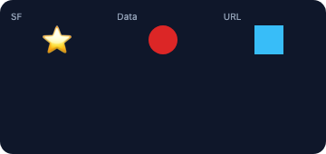
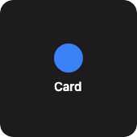
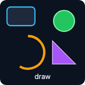

Images, shapes, and declarative canvas.

<!-- generated:elements-media — do not edit; run `pnpm docs:generate` -->

## `image`

**Tier:** core

Image from SF Symbol / drawable name, base64 data, or URL.



_From showcase preset — case `image-sources.medium`._

### Properties

| Property | Type | Default | Description |
| --- | --- | --- | --- |
| `accentable` | `boolean` | `—` | Apple tinted / accented Home Screen: draw this part in the accent color (`widgetAccentable`). Ignored elsewhere. |
| `accessibilityLabel` | `string` | `—` | Text read by screen readers instead of the visible content. |
| `aspectRatio` | `number` | `—` | Keep width / height at this ratio (`1` = square). |
| `background` | `BackgroundValue` | `—` | Solid, adaptive, or gradient background. |
| `bind` | `object` | `—` | Set fields from data with their JSON type: `{"value": "data.progress"}`. Use for numbers / booleans / arrays (`{{…}}` only fills strings). |
| `border` | `BorderConfig` | `—` | Border color and width. |
| `clipShape` | `ClipShape` | `—` | Clip content to a shape (e.g. circle avatar from square image). |
| `color` | `ColorValue` | `—` | Tint color for template / symbol images. |
| `contentMode` | `ContentMode` | `—` | How the image fills its frame (`fit` or `fill`). |
| `cornerRadius` | `number` | `—` | Corner radius in points. |
| `data` | `string` | `—` | Base64-encoded image data (with or without `data:image/...;base64,` prefix). |
| `fallbackSystemName` | `string` | `—` | Symbol shown when `url` / `data` cannot be loaded. |
| `flex` | `number` | `—` | Layout weight for flexible sizing inside stacks (like Android `layout_weight`). |
| `frame` | `FrameConfig` | `—` | Explicit width / height / max constraints. |
| `layoutPriority` | `number` | `—` | Who keeps its size in a crowded stack: higher first. Default `0`. |
| `margin` | `PaddingValue` | `—` | Outer spacing (number or per-edge object), outside background and border. |
| `offsetX` | `number` | `—` | Move right by points after layout (does not affect siblings). |
| `offsetY` | `number` | `—` | Move down by points after layout (does not affect siblings). |
| `opacity` | `number` | `—` | Opacity from `0` (invisible) to `1` (opaque). |
| `padding` | `PaddingValue` | `—` | Inset padding (number or per-edge object). |
| `paletteColors` | `ColorValue[]` | `—` | Colors for `symbolRendering: palette` (primary, secondary, tertiary). |
| `privacySensitive` | `boolean` | `—` | Hide this content where the OS redacts private data (iOS / macOS locked screen, StandBy). Ignored where no redaction exists. |
| `rotation` | `number` | `—` | Rotate by degrees (clockwise). |
| `scale` | `number` | `—` | Scale factor (`1` = unchanged). |
| `shadow` | `ShadowConfig` | `—` | Drop shadow. |
| `size` | `number` | `—` | Display size in points. |
| `symbolRendering` | `SymbolRendering` | `—` | SF Symbol rendering mode (`hierarchical`, `palette`, `multicolor`). Apple; others draw monochrome. |
| `symbolWeight` | `FontWeight` | `—` | SF Symbol stroke weight. Apple only. |
| `systemName` | `string` | `—` | SF Symbol name (Apple) or Material / drawable name (Android). |
| `transition` | `Transition` | `—` | How this element changes between timeline entries / redraws (a hint): `numeric` animates digits, `opacity` cross-fades, `slide` pushes from the bottom. Apple and desktop animate; Android and Adaptive Cards ignore it. |
| `url` | `string` | `—` | Remote image URL (platform support varies — see capability matrix). |
| `when` | `object` | `—` | Show only when the condition holds (`{"path": "data.n", "gt": 0}`; see [`crate::resolve`]). Removed before rendering. |

### Examples

#### Minimal

```json
{
  "type": "image",
  "systemName": "cloud.sun.fill",
  "size": 28,
  "color": "#ffcc00",
  "contentMode": "fit"
}
```

#### From showcase `image-sources.medium`

```json
{
  "type": "image",
  "systemName": "star.fill",
  "size": 32,
  "color": "#fbbf24"
}
```

#### From showcase `link-chip.small`

```json
{
  "type": "image",
  "systemName": "gear",
  "size": 14,
  "color": "#38bdf8"
}
```

#### Inside a `WidgetConfig`

```json
{
  "small": {
    "type": "image",
    "systemName": "cloud.sun.fill",
    "size": 28,
    "color": "#ffcc00",
    "contentMode": "fit"
  }
}
```

## `shape`

**Tier:** core

Colored shape — circle, capsule, or rectangle.



_From showcase preset — case `container-card.small`._

### Properties

| Property | Type | Default | Description |
| --- | --- | --- | --- |
| `accentable` | `boolean` | `—` | Apple tinted / accented Home Screen: draw this part in the accent color (`widgetAccentable`). Ignored elsewhere. |
| `accessibilityLabel` | `string` | `—` | Text read by screen readers instead of the visible content. |
| `aspectRatio` | `number` | `—` | Keep width / height at this ratio (`1` = square). |
| `background` | `BackgroundValue` | `—` | Solid, adaptive, or gradient background. |
| `bind` | `object` | `—` | Set fields from data with their JSON type: `{"value": "data.progress"}`. Use for numbers / booleans / arrays (`{{…}}` only fills strings). |
| `border` | `BorderConfig` | `—` | Border color and width. |
| `clipShape` | `ClipShape` | `—` | Clip content to a shape (e.g. circle avatar from square image). |
| `cornerRadius` | `number` | `—` | Corner radius in points. |
| `fill` | `ColorValue` | `—` | Fill color. |
| `flex` | `number` | `—` | Layout weight for flexible sizing inside stacks (like Android `layout_weight`). |
| `frame` | `FrameConfig` | `—` | Explicit width / height / max constraints. |
| `layoutPriority` | `number` | `—` | Who keeps its size in a crowded stack: higher first. Default `0`. |
| `margin` | `PaddingValue` | `—` | Outer spacing (number or per-edge object), outside background and border. |
| `offsetX` | `number` | `—` | Move right by points after layout (does not affect siblings). |
| `offsetY` | `number` | `—` | Move down by points after layout (does not affect siblings). |
| `opacity` | `number` | `—` | Opacity from `0` (invisible) to `1` (opaque). |
| `padding` | `PaddingValue` | `—` | Inset padding (number or per-edge object). |
| `privacySensitive` | `boolean` | `—` | Hide this content where the OS redacts private data (iOS / macOS locked screen, StandBy). Ignored where no redaction exists. |
| `rotation` | `number` | `—` | Rotate by degrees (clockwise). |
| `scale` | `number` | `—` | Scale factor (`1` = unchanged). |
| `shadow` | `ShadowConfig` | `—` | Drop shadow. |
| `shapeType` | `any` | `—` | Shape kind. |
| `size` | `number` | `—` | Bounding size in points. |
| `stroke` | `ColorValue` | `—` | Stroke color. |
| `strokeWidth` | `number` | `—` | Stroke width in points. |
| `transition` | `Transition` | `—` | How this element changes between timeline entries / redraws (a hint): `numeric` animates digits, `opacity` cross-fades, `slide` pushes from the bottom. Apple and desktop animate; Android and Adaptive Cards ignore it. |
| `when` | `object` | `—` | Show only when the condition holds (`{"path": "data.n", "gt": 0}`; see [`crate::resolve`]). Removed before rendering. |

### Examples

#### Minimal

```json
{
  "type": "shape",
  "shapeType": "capsule",
  "fill": "#ef4444",
  "size": 12,
  "stroke": "#fff",
  "strokeWidth": 1
}
```

#### From showcase `container-card.small`

```json
{
  "type": "shape",
  "shapeType": "circle",
  "size": 36,
  "fill": "#3b82f6"
}
```

#### From showcase `flex-stroke-grid.medium`

```json
{
  "type": "shape",
  "shapeType": "rectangle",
  "size": 36,
  "fill": "#1e293b",
  "stroke": "#22c55e",
  "strokeWidth": 2,
  "cornerRadius": 8,
  "flex": 1
}
```

#### Inside a `WidgetConfig`

```json
{
  "small": {
    "type": "shape",
    "shapeType": "capsule",
    "fill": "#ef4444",
    "size": 12,
    "stroke": "#fff",
    "strokeWidth": 1
  }
}
```

## `canvas`

**Tier:** extended

Declarative canvas — draw arbitrary shapes via JSON commands.



_From showcase preset — case `canvas-draws.small`._

### Properties

| Property | Type | Default | Description |
| --- | --- | --- | --- |
| `accentable` | `boolean` | `—` | Apple tinted / accented Home Screen: draw this part in the accent color (`widgetAccentable`). Ignored elsewhere. |
| `accessibilityLabel` | `string` | `—` | Text read by screen readers instead of the visible content. |
| `aspectRatio` | `number` | `—` | Keep width / height at this ratio (`1` = square). |
| `background` | `BackgroundValue` | `—` | Solid, adaptive, or gradient background. |
| `bind` | `object` | `—` | Set fields from data with their JSON type: `{"value": "data.progress"}`. Use for numbers / booleans / arrays (`{{…}}` only fills strings). |
| `border` | `BorderConfig` | `—` | Border color and width. |
| `clipShape` | `ClipShape` | `—` | Clip content to a shape (e.g. circle avatar from square image). |
| `cornerRadius` | `number` | `—` | Corner radius in points. |
| `elements` | `CanvasDrawCommand[]` | `—` | Draw commands (`circle`, `line`, `rect`, `arc`, `text`, `path`). |
| `flex` | `number` | `—` | Layout weight for flexible sizing inside stacks (like Android `layout_weight`). |
| `frame` | `FrameConfig` | `—` | Explicit width / height / max constraints. |
| `height` | `number` | `—` | Canvas height in points. |
| `layoutPriority` | `number` | `—` | Who keeps its size in a crowded stack: higher first. Default `0`. |
| `margin` | `PaddingValue` | `—` | Outer spacing (number or per-edge object), outside background and border. |
| `offsetX` | `number` | `—` | Move right by points after layout (does not affect siblings). |
| `offsetY` | `number` | `—` | Move down by points after layout (does not affect siblings). |
| `opacity` | `number` | `—` | Opacity from `0` (invisible) to `1` (opaque). |
| `padding` | `PaddingValue` | `—` | Inset padding (number or per-edge object). |
| `privacySensitive` | `boolean` | `—` | Hide this content where the OS redacts private data (iOS / macOS locked screen, StandBy). Ignored where no redaction exists. |
| `rotation` | `number` | `—` | Rotate by degrees (clockwise). |
| `scale` | `number` | `—` | Scale factor (`1` = unchanged). |
| `shadow` | `ShadowConfig` | `—` | Drop shadow. |
| `transition` | `Transition` | `—` | How this element changes between timeline entries / redraws (a hint): `numeric` animates digits, `opacity` cross-fades, `slide` pushes from the bottom. Apple and desktop animate; Android and Adaptive Cards ignore it. |
| `when` | `object` | `—` | Show only when the condition holds (`{"path": "data.n", "gt": 0}`; see [`crate::resolve`]). Removed before rendering. |
| `width` | `number` | `—` | Canvas width in points. |

### Examples

#### Minimal

```json
{
  "type": "canvas",
  "width": 80,
  "height": 80,
  "background": "#0f172a",
  "cornerRadius": 12,
  "elements": [
    {
      "draw": "circle",
      "cx": 40,
      "cy": 40,
      "r": 28,
      "fill": "#1e293b",
      "stroke": "#38bdf8",
      "strokeWidth": 2
    },
    {
      "draw": "text",
      "x": 40,
      "y": 44,
      "content": "72",
      "fontSize": 18,
      "color": "#fff",
      "anchor": "middle"
    }
  ]
}
```

#### From showcase `canvas-draws.small` (size root)

```json
{
  "type": "canvas",
  "width": 146,
  "height": 146,
  "background": "#0b1220",
  "cornerRadius": 12,
  "elements": [
    {
      "draw": "rect",
      "x": 12,
      "y": 12,
      "width": 48,
      "height": 32,
      "fill": "#1e293b",
      "stroke": "#38bdf8",
      "strokeWidth": 2,
      "cornerRadius": 6
    },
    {
      "draw": "circle",
      "cx": 110,
      "cy": 36,
      "r": 18,
      "fill": "#22c55e",
      "stroke": "#86efac",
      "strokeWidth": 2
    },
    {
      "draw": "arc",
      "cx": 48,
      "cy": 90,
      "r": 28,
      "startAngle": -90,
      "endAngle": 120,
      "stroke": "#f59e0b",
      "strokeWidth": 4
    },
    {
      "draw": "path",
      "d": "M90 70 L130 110 L90 110 Z",
      "fill": "#a855f7",
      "stroke": "#e9d5ff",
      "strokeWidth": 1
    },
    {
      "draw": "text",
      "x": 73,
      "y": 136,
      "content": "draw",
      "fontSize": 12,
      "color": "#e2e8f0",
      "anchor": "middle"
    }
  ]
}
```

#### From showcase `canvas-scale.small`

```json
{
  "type": "canvas",
  "width": 60,
  "height": 60,
  "elements": [
    {
      "draw": "circle",
      "cx": 30,
      "cy": 30,
      "r": 25,
      "fill": "#1e40af",
      "stroke": "#fff",
      "strokeWidth": 2
    },
    {
      "draw": "line",
      "x1": 30,
      "y1": 30,
      "x2": 30,
      "y2": 10,
      "stroke": "#fff",
      "strokeWidth": 2
    }
  ]
}
```

#### Inside a `WidgetConfig`

```json
{
  "small": {
    "type": "canvas",
    "width": 80,
    "height": 80,
    "background": "#0f172a",
    "cornerRadius": 12,
    "elements": [
      {
        "draw": "circle",
        "cx": 40,
        "cy": 40,
        "r": 28,
        "fill": "#1e293b",
        "stroke": "#38bdf8",
        "strokeWidth": 2
      },
      {
        "draw": "text",
        "x": 40,
        "y": 44,
        "content": "72",
        "fontSize": 18,
        "color": "#fff",
        "anchor": "middle"
      }
    ]
  }
}
```

<!-- /generated:elements-media -->
