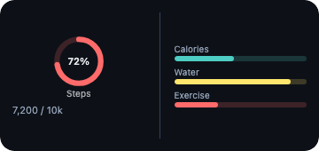
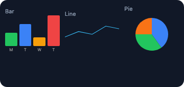
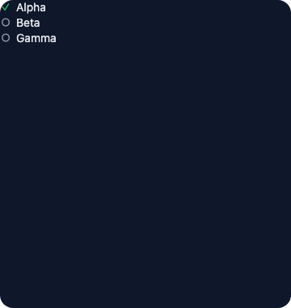

Progress, gauges, charts, and lists.

<!-- generated:elements-data — do not edit; run `pnpm docs:generate` -->

## `progress`

**Tier:** core

Linear or circular progress indicator.



_From showcase preset — case `fitness.medium`._

### Properties

| Property | Type | Default | Description |
| --- | --- | --- | --- |
| `accentable` | `boolean` | `—` | Apple tinted / accented Home Screen: draw this part in the accent color (`widgetAccentable`). Ignored elsewhere. |
| `accessibilityLabel` | `string` | `—` | Text read by screen readers instead of the visible content. |
| `aspectRatio` | `number` | `—` | Keep width / height at this ratio (`1` = square). |
| `background` | `BackgroundValue` | `—` | Solid, adaptive, or gradient background. |
| `barStyle` | `ProgressStyle` | `—` | `linear` (default) or `circular`. |
| `bind` | `object` | `—` | Set fields from data with their JSON type: `{"value": "data.progress"}`. Use for numbers / booleans / arrays (`{{…}}` only fills strings). |
| `border` | `BorderConfig` | `—` | Border color and width. |
| `clipShape` | `ClipShape` | `—` | Clip content to a shape (e.g. circle avatar from square image). |
| `color` | `ColorValue` | `—` | Track / label color. |
| `cornerRadius` | `number` | `—` | Corner radius in points. |
| `endAt` | `integer` | `—` | Unix ms the time-driven bar reaches full (see `startAt`). |
| `flex` | `number` | `—` | Layout weight for flexible sizing inside stacks (like Android `layout_weight`). |
| `frame` | `FrameConfig` | `—` | Explicit width / height / max constraints. |
| `label` | `string` | `—` | Caption above the bar. Always set on Android so hosts never show null. |
| `layoutPriority` | `number` | `—` | Who keeps its size in a crowded stack: higher first. Default `0`. |
| `margin` | `PaddingValue` | `—` | Outer spacing (number or per-edge object), outside background and border. |
| `offsetX` | `number` | `—` | Move right by points after layout (does not affect siblings). |
| `offsetY` | `number` | `—` | Move down by points after layout (does not affect siblings). |
| `opacity` | `number` | `—` | Opacity from `0` (invisible) to `1` (opaque). |
| `padding` | `PaddingValue` | `—` | Inset padding (number or per-edge object). |
| `privacySensitive` | `boolean` | `—` | Hide this content where the OS redacts private data (iOS / macOS locked screen, StandBy). Ignored where no redaction exists. |
| `rotation` | `number` | `—` | Rotate by degrees (clockwise). |
| `scale` | `number` | `—` | Scale factor (`1` = unchanged). |
| `shadow` | `ShadowConfig` | `—` | Drop shadow. |
| `startAt` | `integer` | `—` | Unix ms: with `endAt`, the bar fills by itself between the two times (no refresh needed on Apple / desktop). WidgetKit animates it live only for spans up to 10 minutes (a live bar keeps Notification Center busy); a longer span shows the value at each timeline entry / reload. |
| `thickness` | `number` | `—` | Bar height (linear) or ring width (circular) in points. |
| `tint` | `ColorValue` | `—` | Accent / fill color for the completed portion. |
| `total` | `number` | `1` | Denominator for the ratio. Default `1.0`. |
| `trackColor` | `ColorValue` | `—` | Color of the unfilled track. |
| `transition` | `Transition` | `—` | How this element changes between timeline entries / redraws (a hint): `numeric` animates digits, `opacity` cross-fades, `slide` pushes from the bottom. Apple and desktop animate; Android and Adaptive Cards ignore it. |
| `value` | `number` | `—` | Current value. Clamped to `0..=total` by renderers. |
| `when` | `object` | `—` | Show only when the condition holds (`{"path": "data.n", "gt": 0}`; see [`crate::resolve`]). Removed before rendering. |

### Examples

#### Minimal

```json
{
  "type": "progress",
  "value": 0.7,
  "total": 1,
  "tint": "#4CAF50",
  "color": "secondaryLabel",
  "label": "Humidity",
  "barStyle": "linear"
}
```

#### From showcase `fitness.medium`

```json
{
  "type": "progress",
  "value": 0.45,
  "tint": "#4ecdc4",
  "label": "Calories",
  "color": "#94a3b8"
}
```

#### From showcase `fitness.small`

```json
{
  "type": "progress",
  "value": 0.45,
  "tint": "#4ecdc4",
  "label": "Cal",
  "color": "#94a3b8"
}
```

#### Inside a `WidgetConfig`

```json
{
  "small": {
    "type": "progress",
    "value": 0.7,
    "total": 1,
    "tint": "#4CAF50",
    "color": "secondaryLabel",
    "label": "Humidity",
    "barStyle": "linear"
  }
}
```

## `gauge`

**Tier:** extended

Circular or capacity-style gauge.


_From showcase preset — case `fitness.medium`._

### Properties

| Property | Type | Default | Description |
| --- | --- | --- | --- |
| `accentable` | `boolean` | `—` | Apple tinted / accented Home Screen: draw this part in the accent color (`widgetAccentable`). Ignored elsewhere. |
| `accessibilityLabel` | `string` | `—` | Text read by screen readers instead of the visible content. |
| `aspectRatio` | `number` | `—` | Keep width / height at this ratio (`1` = square). |
| `background` | `BackgroundValue` | `—` | Solid, adaptive, or gradient background. |
| `bind` | `object` | `—` | Set fields from data with their JSON type: `{"value": "data.progress"}`. Use for numbers / booleans / arrays (`{{…}}` only fills strings). |
| `border` | `BorderConfig` | `—` | Border color and width. |
| `clipShape` | `ClipShape` | `—` | Clip content to a shape (e.g. circle avatar from square image). |
| `color` | `ColorValue` | `—` | Secondary / track color. |
| `cornerRadius` | `number` | `—` | Corner radius in points. |
| `currentValueLabel` | `string` | `—` | Text shown for the current value (e.g. `"72%"`). |
| `endAt` | `integer` | `—` | Unix ms the time-driven gauge reaches `max`. |
| `flex` | `number` | `—` | Layout weight for flexible sizing inside stacks (like Android `layout_weight`). |
| `frame` | `FrameConfig` | `—` | Explicit width / height / max constraints. |
| `gaugeStyle` | `GaugeStyle` | `—` | Visual style (e.g. `circular`). |
| `label` | `string` | `—` | Optional caption. |
| `layoutPriority` | `number` | `—` | Who keeps its size in a crowded stack: higher first. Default `0`. |
| `margin` | `PaddingValue` | `—` | Outer spacing (number or per-edge object), outside background and border. |
| `max` | `number` | `—` | Upper bound. Default `1`. |
| `maxLabel` | `string` | `—` | Label at the maximum end. |
| `min` | `number` | `—` | Lower bound. Default `0`. |
| `minLabel` | `string` | `—` | Label at the minimum end. |
| `offsetX` | `number` | `—` | Move right by points after layout (does not affect siblings). |
| `offsetY` | `number` | `—` | Move down by points after layout (does not affect siblings). |
| `opacity` | `number` | `—` | Opacity from `0` (invisible) to `1` (opaque). |
| `padding` | `PaddingValue` | `—` | Inset padding (number or per-edge object). |
| `privacySensitive` | `boolean` | `—` | Hide this content where the OS redacts private data (iOS / macOS locked screen, StandBy). Ignored where no redaction exists. |
| `rotation` | `number` | `—` | Rotate by degrees (clockwise). |
| `scale` | `number` | `—` | Scale factor (`1` = unchanged). |
| `shadow` | `ShadowConfig` | `—` | Drop shadow. |
| `startAt` | `integer` | `—` | Unix ms: with `endAt`, the gauge moves by itself between the two times. |
| `tint` | `ColorValue` | `—` | Accent color. |
| `transition` | `Transition` | `—` | How this element changes between timeline entries / redraws (a hint): `numeric` animates digits, `opacity` cross-fades, `slide` pushes from the bottom. Apple and desktop animate; Android and Adaptive Cards ignore it. |
| `value` | `number` | `—` | Current value within `[min, max]`. |
| `when` | `object` | `—` | Show only when the condition holds (`{"path": "data.n", "gt": 0}`; see [`crate::resolve`]). Removed before rendering. |

### Examples

#### Minimal

```json
{
  "type": "gauge",
  "value": 0.72,
  "min": 0,
  "max": 1,
  "label": "CPU",
  "currentValueLabel": "72%",
  "tint": "#38bdf8",
  "gaugeStyle": "circular"
}
```

#### From showcase `fitness.medium`

```json
{
  "type": "gauge",
  "value": 0.72,
  "min": 0,
  "max": 1,
  "currentValueLabel": "72%",
  "label": "Steps",
  "gaugeStyle": "circular",
  "tint": "#ff6b6b"
}
```

#### From showcase `gauge-square.small`

```json
{
  "type": "gauge",
  "value": 0.72,
  "min": 0,
  "max": 1,
  "label": "CPU",
  "currentValueLabel": "72%",
  "tint": "#7aa2f7",
  "gaugeStyle": "circular"
}
```

#### Inside a `WidgetConfig`

```json
{
  "small": {
    "type": "gauge",
    "value": 0.72,
    "min": 0,
    "max": 1,
    "label": "CPU",
    "currentValueLabel": "72%",
    "tint": "#38bdf8",
    "gaugeStyle": "circular"
  }
}
```

## `chart`

**Tier:** extended

Bar, line, area, or pie chart.



_From showcase preset — case `chart-mix.medium`._

### Properties

| Property | Type | Default | Description |
| --- | --- | --- | --- |
| `accentable` | `boolean` | `—` | Apple tinted / accented Home Screen: draw this part in the accent color (`widgetAccentable`). Ignored elsewhere. |
| `accessibilityLabel` | `string` | `—` | Text read by screen readers instead of the visible content. |
| `aspectRatio` | `number` | `—` | Keep width / height at this ratio (`1` = square). |
| `background` | `BackgroundValue` | `—` | Solid, adaptive, or gradient background. |
| `bind` | `object` | `—` | Set fields from data with their JSON type: `{"value": "data.progress"}`. Use for numbers / booleans / arrays (`{{…}}` only fills strings). |
| `border` | `BorderConfig` | `—` | Border color and width. |
| `chartData` | `ChartDataPoint[]` | `—` | Data points (`label` + `value`, optional per-point `color`). |
| `chartType` | `any` | `—` | Chart kind: `bar`, `line`, `area`, or `pie`. |
| `clipShape` | `ClipShape` | `—` | Clip content to a shape (e.g. circle avatar from square image). |
| `cornerRadius` | `number` | `—` | Corner radius in points. |
| `flex` | `number` | `—` | Layout weight for flexible sizing inside stacks (like Android `layout_weight`). |
| `frame` | `FrameConfig` | `—` | Explicit width / height / max constraints. |
| `innerRadius` | `number` | `—` | Pie hole as a fraction of the radius (`0.6` = donut). Default `0`. |
| `interpolation` | `ChartInterpolation` | `—` | Line / area curve: `linear` (default), `monotone`, `step`. |
| `layoutPriority` | `number` | `—` | Who keeps its size in a crowded stack: higher first. Default `0`. |
| `margin` | `PaddingValue` | `—` | Outer spacing (number or per-edge object), outside background and border. |
| `offsetX` | `number` | `—` | Move right by points after layout (does not affect siblings). |
| `offsetY` | `number` | `—` | Move down by points after layout (does not affect siblings). |
| `opacity` | `number` | `—` | Opacity from `0` (invisible) to `1` (opaque). |
| `padding` | `PaddingValue` | `—` | Inset padding (number or per-edge object). |
| `privacySensitive` | `boolean` | `—` | Hide this content where the OS redacts private data (iOS / macOS locked screen, StandBy). Ignored where no redaction exists. |
| `rotation` | `number` | `—` | Rotate by degrees (clockwise). |
| `scale` | `number` | `—` | Scale factor (`1` = unchanged). |
| `shadow` | `ShadowConfig` | `—` | Drop shadow. |
| `showLegend` | `boolean` | `—` | Show a legend of `series` (or pie slices). Default `false`. |
| `showXAxis` | `boolean` | `—` | Show the x axis labels (bar / line / area). Unset keeps each platform's classic chart (labels on Apple and desktop, none on Android); set it to match. |
| `showYAxis` | `boolean` | `—` | Show the y axis. Default `false`. |
| `tint` | `ColorValue` | `—` | Default series tint. |
| `transition` | `Transition` | `—` | How this element changes between timeline entries / redraws (a hint): `numeric` animates digits, `opacity` cross-fades, `slide` pushes from the bottom. Apple and desktop animate; Android and Adaptive Cards ignore it. |
| `when` | `object` | `—` | Show only when the condition holds (`{"path": "data.n", "gt": 0}`; see [`crate::resolve`]). Removed before rendering. |
| `yMax` | `number` | `—` | Upper bound of the y scale (default: data maximum). |
| `yMin` | `number` | `—` | Lower bound of the y scale (default: data minimum or 0). |

### Examples

#### Minimal

```json
{
  "type": "chart",
  "chartType": "bar",
  "tint": "#38bdf8",
  "chartData": [
    {
      "label": "Mon",
      "value": 120
    },
    {
      "label": "Tue",
      "value": 90
    },
    {
      "label": "Wed",
      "value": 150
    }
  ]
}
```

#### From showcase `chart-mix.medium`

```json
{
  "type": "chart",
  "chartType": "bar",
  "tint": "#22c55e",
  "chartData": [
    {
      "label": "M",
      "value": 3,
      "color": "#22c55e"
    },
    {
      "label": "T",
      "value": 5,
      "color": "#3b82f6"
    },
    {
      "label": "W",
      "value": 2,
      "color": "#f59e0b"
    },
    {
      "label": "T",
      "value": 7,
      "color": "#ef4444"
    }
  ]
}
```

#### From showcase `stress-nest.large`

```json
{
  "type": "chart",
  "chartType": "bar",
  "flex": 1,
  "tint": "#38bdf8",
  "chartData": [
    {
      "label": "a",
      "value": 2,
      "color": "#38bdf8"
    },
    {
      "label": "b",
      "value": 5,
      "color": "#818cf8"
    },
    {
      "label": "c",
      "value": 1,
      "color": "#c084fc"
    },
    {
      "label": "d",
      "value": 7,
      "color": "#f472b6"
    },
    {
      "label": "e",
      "value": 4,
      "color": "#fb7185"
    }
  ]
}
```

#### Inside a `WidgetConfig`

```json
{
  "small": {
    "type": "chart",
    "chartType": "bar",
    "tint": "#38bdf8",
    "chartData": [
      {
        "label": "Mon",
        "value": 120
      },
      {
        "label": "Tue",
        "value": 90
      },
      {
        "label": "Wed",
        "value": 150
      }
    ]
  }
}
```

## `list`

**Tier:** extended

Collection list of rows (text, optional checked marker and action).



_From showcase preset — case `android-list.large`._

### Properties

| Property | Type | Default | Description |
| --- | --- | --- | --- |
| `accentable` | `boolean` | `—` | Apple tinted / accented Home Screen: draw this part in the accent color (`widgetAccentable`). Ignored elsewhere. |
| `accessibilityLabel` | `string` | `—` | Text read by screen readers instead of the visible content. |
| `aspectRatio` | `number` | `—` | Keep width / height at this ratio (`1` = square). |
| `background` | `BackgroundValue` | `—` | Solid, adaptive, or gradient background. |
| `bind` | `object` | `—` | Set fields from data with their JSON type: `{"value": "data.progress"}`. Use for numbers / booleans / arrays (`{{…}}` only fills strings). |
| `border` | `BorderConfig` | `—` | Border color and width. |
| `children` | `WidgetElement[]` | `—` | Rich rows as nested elements (alternative to typed [`ListItem`]s). |
| `clipShape` | `ClipShape` | `—` | Clip content to a shape (e.g. circle avatar from square image). |
| `color` | `ColorValue` | `—` | Row text color. |
| `cornerRadius` | `number` | `—` | Corner radius in points. |
| `flex` | `number` | `—` | Layout weight for flexible sizing inside stacks (like Android `layout_weight`). |
| `fontSize` | `number` | `—` | Row text font size. |
| `frame` | `FrameConfig` | `—` | Explicit width / height / max constraints. |
| `items` | `ListItem[]` | `—` | Row items. |
| `layoutPriority` | `number` | `—` | Who keeps its size in a crowded stack: higher first. Default `0`. |
| `margin` | `PaddingValue` | `—` | Outer spacing (number or per-edge object), outside background and border. |
| `offsetX` | `number` | `—` | Move right by points after layout (does not affect siblings). |
| `offsetY` | `number` | `—` | Move down by points after layout (does not affect siblings). |
| `opacity` | `number` | `—` | Opacity from `0` (invisible) to `1` (opaque). |
| `padding` | `PaddingValue` | `—` | Inset padding (number or per-edge object). |
| `privacySensitive` | `boolean` | `—` | Hide this content where the OS redacts private data (iOS / macOS locked screen, StandBy). Ignored where no redaction exists. |
| `rotation` | `number` | `—` | Rotate by degrees (clockwise). |
| `scale` | `number` | `—` | Scale factor (`1` = unchanged). |
| `shadow` | `ShadowConfig` | `—` | Drop shadow. |
| `spacing` | `number` | `—` | Space between rows (points). |
| `transition` | `Transition` | `—` | How this element changes between timeline entries / redraws (a hint): `numeric` animates digits, `opacity` cross-fades, `slide` pushes from the bottom. Apple and desktop animate; Android and Adaptive Cards ignore it. |
| `when` | `object` | `—` | Show only when the condition holds (`{"path": "data.n", "gt": 0}`; see [`crate::resolve`]). Removed before rendering. |

### Examples

#### Minimal

```json
{
  "type": "list",
  "spacing": 4,
  "fontSize": 14,
  "items": [
    {
      "text": "Alpha",
      "checked": true,
      "action": "row",
      "payload": "a"
    },
    {
      "text": "Beta",
      "checked": false,
      "action": "row",
      "payload": "b"
    },
    {
      "text": "Gamma"
    }
  ]
}
```

#### From showcase `android-list.large` (size root)

```json
{
  "type": "list",
  "items": [
    {
      "text": "Alpha",
      "checked": true,
      "action": "row",
      "payload": "a"
    },
    {
      "text": "Beta",
      "checked": false,
      "action": "row",
      "payload": "b"
    },
    {
      "text": "Gamma"
    }
  ],
  "spacing": 2,
  "fontSize": 14
}
```

#### From showcase `list-20-items.large` (size root)

```json
{
  "type": "list",
  "spacing": 2,
  "fontSize": 12,
  "color": "#e2e8f0",
  "background": "#0f172a",
  "padding": 8,
  "items": [
    {
      "text": "Item 01",
      "checked": false
    },
    {
      "text": "Item 02",
      "checked": true
    },
    {
      "text": "Item 03"
    },
    {
      "text": "Item 04"
    }
  ]
}
```

#### Inside a `WidgetConfig`

```json
{
  "small": {
    "type": "list",
    "spacing": 4,
    "fontSize": 14,
    "items": [
      {
        "text": "Alpha",
        "checked": true,
        "action": "row",
        "payload": "a"
      },
      {
        "text": "Beta",
        "checked": false,
        "action": "row",
        "payload": "b"
      },
      {
        "text": "Gamma"
      }
    ]
  }
}
```

<!-- /generated:elements-data -->
