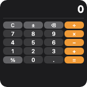
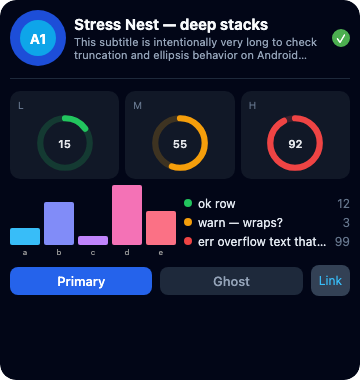
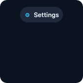

Buttons, toggles, and tappable wrappers.

<!-- generated:elements-interactive — do not edit; run `pnpm docs:generate` -->

## `button`

**Tier:** core

Tappable button that opens a URL or emits `widget-action`.



_From showcase preset — case `calculator.small`._

### Properties

| Property | Type | Default | Description |
| --- | --- | --- | --- |
| `accentable` | `boolean` | `—` | Apple tinted / accented Home Screen: draw this part in the accent color (`widgetAccentable`). Ignored elsewhere. |
| `accessibilityLabel` | `string` | `—` | Text read by screen readers instead of the visible content. |
| `action` | `string` | `—` | Action identifier — emits a `widget-action` Tauri event when tapped. |
| `aspectRatio` | `number` | `—` | Keep width / height at this ratio (`1` = square). |
| `background` | `BackgroundValue` | `—` | Solid, adaptive, or gradient background. |
| `backgroundColor` | `ColorValue` | `—` | Button background color. |
| `bind` | `object` | `—` | Set fields from data with their JSON type: `{"value": "data.progress"}`. Use for numbers / booleans / arrays (`{{…}}` only fills strings). |
| `border` | `BorderConfig` | `—` | Border color and width. |
| `clipShape` | `ClipShape` | `—` | Clip content to a shape (e.g. circle avatar from square image). |
| `color` | `ColorValue` | `—` | Label text color. |
| `cornerRadius` | `number` | `—` | Corner radius in points. |
| `disabled` | `boolean` | `—` | Draw dimmed and ignore taps. |
| `flex` | `number` | `—` | Layout weight for flexible sizing inside stacks (like Android `layout_weight`). |
| `fontSize` | `number` | `—` | Label font size in points. |
| `frame` | `FrameConfig` | `—` | Explicit width / height / max constraints. |
| `label` | `string` | `—` | Button label text. |
| `layoutPriority` | `number` | `—` | Who keeps its size in a crowded stack: higher first. Default `0`. |
| `margin` | `PaddingValue` | `—` | Outer spacing (number or per-edge object), outside background and border. |
| `offsetX` | `number` | `—` | Move right by points after layout (does not affect siblings). |
| `offsetY` | `number` | `—` | Move down by points after layout (does not affect siblings). |
| `opacity` | `number` | `—` | Opacity from `0` (invisible) to `1` (opaque). |
| `padding` | `PaddingValue` | `—` | Inset padding (number or per-edge object). |
| `privacySensitive` | `boolean` | `—` | Hide this content where the OS redacts private data (iOS / macOS locked screen, StandBy). Ignored where no redaction exists. |
| `rotation` | `number` | `—` | Rotate by degrees (clockwise). |
| `scale` | `number` | `—` | Scale factor (`1` = unchanged). |
| `set` | `object` | `—` | Local state written on tap, in-process (no app needed): `{"done": "$toggle"}`. `"$toggle"` flips a boolean (missing → `true`), `"$inc"` / `"$dec"` add / subtract 1 (missing → 0 first), `null` removes the key (the default shows again), any other JSON is stored as is. With `action` too, the action is sent after the write. |
| `shadow` | `ShadowConfig` | `—` | Drop shadow. |
| `systemName` | `string` | `—` | Icon (SF Symbol name; Material / emoji elsewhere) before the label. |
| `textAlignment` | `TextAlignment` | `—` | Label text alignment. |
| `transition` | `Transition` | `—` | How this element changes between timeline entries / redraws (a hint): `numeric` animates digits, `opacity` cross-fades, `slide` pushes from the bottom. Apple and desktop animate; Android and Adaptive Cards ignore it. |
| `url` | `string` | `—` | Deep link URL to open the app (used when no action is set). |
| `variant` | `ButtonVariant` | `—` | Visual style (`bordered`, `prominent`, `plain`, `outline`). Unset keeps each platform's classic button look; set it for the same look everywhere. |
| `when` | `object` | `—` | Show only when the condition holds (`{"path": "data.n", "gt": 0}`; see [`crate::resolve`]). Removed before rendering. |

### Examples

#### Minimal

```json
{
  "type": "button",
  "label": "Refresh",
  "action": "refresh",
  "color": "#fff",
  "backgroundColor": "#0284c7",
  "fontSize": 14,
  "cornerRadius": 10
}
```

#### From showcase `calculator.small`

```json
{
  "type": "button",
  "label": "C",
  "action": "calc:C",
  "backgroundColor": "#636366",
  "color": "#fff",
  "fontSize": 10,
  "cornerRadius": 6,
  "padding": {
    "top": 1,
    "bottom": 1,
    "leading": 2,
    "trailing": 2
  }
}
```

#### From showcase `layout.small`

```json
{
  "type": "button",
  "label": "Go",
  "action": "go",
  "backgroundColor": "#2196F3",
  "color": "#fff"
}
```

#### Inside a `WidgetConfig`

```json
{
  "small": {
    "type": "button",
    "label": "Refresh",
    "action": "refresh",
    "color": "#fff",
    "backgroundColor": "#0284c7",
    "fontSize": 14,
    "cornerRadius": 10
  }
}
```

## `toggle`

**Tier:** extended

On/off toggle control.



_From showcase preset — case `stress-nest.large`._

### Properties

| Property | Type | Default | Description |
| --- | --- | --- | --- |
| `accentable` | `boolean` | `—` | Apple tinted / accented Home Screen: draw this part in the accent color (`widgetAccentable`). Ignored elsewhere. |
| `accessibilityLabel` | `string` | `—` | Text read by screen readers instead of the visible content. |
| `action` | `string` | `—` | Action identifier sent back to the app. |
| `aspectRatio` | `number` | `—` | Keep width / height at this ratio (`1` = square). |
| `background` | `BackgroundValue` | `—` | Solid, adaptive, or gradient background. |
| `bind` | `object` | `—` | Set fields from data with their JSON type: `{"value": "data.progress"}`. Use for numbers / booleans / arrays (`{{…}}` only fills strings). |
| `border` | `BorderConfig` | `—` | Border color and width. |
| `clipShape` | `ClipShape` | `—` | Clip content to a shape (e.g. circle avatar from square image). |
| `cornerRadius` | `number` | `—` | Corner radius in points. |
| `flex` | `number` | `—` | Layout weight for flexible sizing inside stacks (like Android `layout_weight`). |
| `frame` | `FrameConfig` | `—` | Explicit width / height / max constraints. |
| `isOn` | `boolean` | `—` | Whether the toggle is on. |
| `label` | `string` | `—` | Optional label beside the control. |
| `layoutPriority` | `number` | `—` | Who keeps its size in a crowded stack: higher first. Default `0`. |
| `margin` | `PaddingValue` | `—` | Outer spacing (number or per-edge object), outside background and border. |
| `offsetX` | `number` | `—` | Move right by points after layout (does not affect siblings). |
| `offsetY` | `number` | `—` | Move down by points after layout (does not affect siblings). |
| `opacity` | `number` | `—` | Opacity from `0` (invisible) to `1` (opaque). |
| `padding` | `PaddingValue` | `—` | Inset padding (number or per-edge object). |
| `privacySensitive` | `boolean` | `—` | Hide this content where the OS redacts private data (iOS / macOS locked screen, StandBy). Ignored where no redaction exists. |
| `rotation` | `number` | `—` | Rotate by degrees (clockwise). |
| `scale` | `number` | `—` | Scale factor (`1` = unchanged). |
| `set` | `object` | `—` | Local state written on tap, in-process (no app needed): `{"done": "$toggle"}`. `"$toggle"` flips a boolean (missing → `true`), `"$inc"` / `"$dec"` add / subtract 1 (missing → 0 first), `null` removes the key (the default shows again), any other JSON is stored as is. With `action` too, the action is sent after the write. |
| `shadow` | `ShadowConfig` | `—` | Drop shadow. |
| `tint` | `ColorValue` | `—` | Accent color when on. |
| `transition` | `Transition` | `—` | How this element changes between timeline entries / redraws (a hint): `numeric` animates digits, `opacity` cross-fades, `slide` pushes from the bottom. Apple and desktop animate; Android and Adaptive Cards ignore it. |
| `uncheckedTint` | `ColorValue` | `—` | Color when off. |
| `variant` | `ToggleVariant` | `—` | `switch` or `checkbox`. Unset keeps each platform's classic toggle (a glyph on Android); set it for the same control everywhere. |
| `when` | `object` | `—` | Show only when the condition holds (`{"path": "data.n", "gt": 0}`; see [`crate::resolve`]). Removed before rendering. |

### Examples

#### Minimal

```json
{
  "type": "toggle",
  "isOn": true,
  "label": "Dark mode",
  "tint": "#38bdf8",
  "action": "toggle-dark"
}
```

#### From showcase `stress-nest.large`

```json
{
  "type": "toggle",
  "isOn": true,
  "action": "stress_toggle"
}
```

#### From showcase `toggle-row.small`

```json
{
  "type": "toggle",
  "isOn": true,
  "label": "Wi-Fi",
  "tint": "#22c55e",
  "color": "#e2e8f0",
  "action": "toggle_wifi"
}
```

#### Inside a `WidgetConfig`

```json
{
  "small": {
    "type": "toggle",
    "isOn": true,
    "label": "Dark mode",
    "tint": "#38bdf8",
    "action": "toggle-dark"
  }
}
```

## `link`

**Tier:** core

Tappable wrapper — makes nested content clickable.



_From showcase preset — case `link-chip.small`._

### Properties

| Property | Type | Default | Description |
| --- | --- | --- | --- |
| `accentable` | `boolean` | `—` | Apple tinted / accented Home Screen: draw this part in the accent color (`widgetAccentable`). Ignored elsewhere. |
| `accessibilityLabel` | `string` | `—` | Text read by screen readers instead of the visible content. |
| `action` | `string` | `—` | Action identifier — emits `widget-action` event. |
| `aspectRatio` | `number` | `—` | Keep width / height at this ratio (`1` = square). |
| `background` | `BackgroundValue` | `—` | Solid, adaptive, or gradient background. |
| `bind` | `object` | `—` | Set fields from data with their JSON type: `{"value": "data.progress"}`. Use for numbers / booleans / arrays (`{{…}}` only fills strings). |
| `border` | `BorderConfig` | `—` | Border color and width. |
| `children` | `WidgetElement[]` | `—` | Nested content to wrap. |
| `clipShape` | `ClipShape` | `—` | Clip content to a shape (e.g. circle avatar from square image). |
| `cornerRadius` | `number` | `—` | Corner radius in points. |
| `flex` | `number` | `—` | Layout weight for flexible sizing inside stacks (like Android `layout_weight`). |
| `frame` | `FrameConfig` | `—` | Explicit width / height / max constraints. |
| `layoutPriority` | `number` | `—` | Who keeps its size in a crowded stack: higher first. Default `0`. |
| `margin` | `PaddingValue` | `—` | Outer spacing (number or per-edge object), outside background and border. |
| `offsetX` | `number` | `—` | Move right by points after layout (does not affect siblings). |
| `offsetY` | `number` | `—` | Move down by points after layout (does not affect siblings). |
| `opacity` | `number` | `—` | Opacity from `0` (invisible) to `1` (opaque). |
| `padding` | `PaddingValue` | `—` | Inset padding (number or per-edge object). |
| `privacySensitive` | `boolean` | `—` | Hide this content where the OS redacts private data (iOS / macOS locked screen, StandBy). Ignored where no redaction exists. |
| `rotation` | `number` | `—` | Rotate by degrees (clockwise). |
| `scale` | `number` | `—` | Scale factor (`1` = unchanged). |
| `set` | `object` | `—` | Local state written on tap, in-process (no app needed): `{"done": "$toggle"}`. `"$toggle"` flips a boolean (missing → `true`), `"$inc"` / `"$dec"` add / subtract 1 (missing → 0 first), `null` removes the key (the default shows again), any other JSON is stored as is. With `action` too, the action is sent after the write. |
| `shadow` | `ShadowConfig` | `—` | Drop shadow. |
| `transition` | `Transition` | `—` | How this element changes between timeline entries / redraws (a hint): `numeric` animates digits, `opacity` cross-fades, `slide` pushes from the bottom. Apple and desktop animate; Android and Adaptive Cards ignore it. |
| `url` | `string` | `—` | Deep-link URL to open. |
| `when` | `object` | `—` | Show only when the condition holds (`{"path": "data.n", "gt": 0}`; see [`crate::resolve`]). Removed before rendering. |

### Examples

#### Minimal

```json
{
  "type": "link",
  "action": "open-details",
  "payload": "item-1",
  "children": [
    {
      "type": "hstack",
      "spacing": 6,
      "alignment": "center",
      "children": [
        {
          "type": "text",
          "content": "Details",
          "color": "#38bdf8",
          "fontWeight": "medium"
        },
        {
          "type": "image",
          "systemName": "chevron.right",
          "size": 12,
          "color": "#38bdf8"
        }
      ]
    }
  ]
}
```

#### From showcase `link-chip.small`

```json
{
  "type": "link",
  "action": "open_settings",
  "padding": 8,
  "cornerRadius": 999,
  "background": "#1e293b",
  "children": [
    {
      "type": "hstack",
      "spacing": 6,
      "alignment": "center",
      "children": [
        {
          "type": "image",
          "systemName": "gear",
          "size": 14,
          "color": "#38bdf8"
        },
        {
          "type": "text",
          "content": "Settings",
          "fontSize": 13,
          "fontWeight": "medium",
          "color": "#e2e8f0"
        }
      ]
    }
  ]
}
```

#### From showcase `stress-nest.large`

```json
{
  "type": "link",
  "action": "open_settings",
  "padding": 8,
  "cornerRadius": 8,
  "background": "#334155",
  "children": [
    {
      "type": "text",
      "content": "Link",
      "fontSize": 12,
      "color": "#38bdf8"
    }
  ]
}
```

#### Inside a `WidgetConfig`

```json
{
  "small": {
    "type": "link",
    "action": "open-details",
    "payload": "item-1",
    "children": [
      {
        "type": "hstack",
        "spacing": 6,
        "alignment": "center",
        "children": [
          {
            "type": "text",
            "content": "Details",
            "color": "#38bdf8",
            "fontWeight": "medium"
          },
          {
            "type": "image",
            "systemName": "chevron.right",
            "size": 12,
            "color": "#38bdf8"
          }
        ]
      }
    ]
  }
}
```

<!-- /generated:elements-interactive -->
