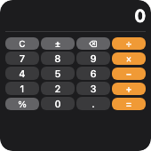

Spacers and dividers.

<!-- generated:elements-spacing — do not edit; run `pnpm docs:generate` -->

## `spacer`

**Tier:** core

Flexible empty space.



_From showcase preset — case `calculator.small`._

### Properties

| Property | Type | Default | Description |
| --- | --- | --- | --- |
| `minLength` | `number` | `—` | Minimum length along the parent axis (points). |

### Examples

#### Minimal

```json
{
  "type": "spacer",
  "minLength": 8
}
```

#### From showcase `calculator.small`

```json
{
  "type": "spacer"
}
```

#### From showcase `upcoming-payments.large`

```json
{
  "type": "spacer",
  "minLength": 4
}
```

#### Inside a `WidgetConfig`

```json
{
  "small": {
    "type": "spacer",
    "minLength": 8
  }
}
```

## `divider`

**Tier:** core

Horizontal or vertical rule.


_From showcase preset — case `calculator.small`._

### Properties

| Property | Type | Default | Description |
| --- | --- | --- | --- |
| `accentable` | `boolean` | `—` | Apple tinted / accented Home Screen: draw this part in the accent color (`widgetAccentable`). Ignored elsewhere. |
| `accessibilityLabel` | `string` | `—` | Text read by screen readers instead of the visible content. |
| `aspectRatio` | `number` | `—` | Keep width / height at this ratio (`1` = square). |
| `background` | `BackgroundValue` | `—` | Solid, adaptive, or gradient background. |
| `bind` | `object` | `—` | Set fields from data with their JSON type: `{"value": "data.progress"}`. Use for numbers / booleans / arrays (`{{…}}` only fills strings). |
| `border` | `BorderConfig` | `—` | Border color and width. |
| `clipShape` | `ClipShape` | `—` | Clip content to a shape (e.g. circle avatar from square image). |
| `color` | `ColorValue` | `—` | Line color. |
| `cornerRadius` | `number` | `—` | Corner radius in points. |
| `flex` | `number` | `—` | Layout weight for flexible sizing inside stacks (like Android `layout_weight`). |
| `frame` | `FrameConfig` | `—` | Explicit width / height / max constraints. |
| `layoutPriority` | `number` | `—` | Who keeps its size in a crowded stack: higher first. Default `0`. |
| `margin` | `PaddingValue` | `—` | Outer spacing (number or per-edge object), outside background and border. |
| `offsetX` | `number` | `—` | Move right by points after layout (does not affect siblings). |
| `offsetY` | `number` | `—` | Move down by points after layout (does not affect siblings). |
| `opacity` | `number` | `—` | Opacity from `0` (invisible) to `1` (opaque). |
| `padding` | `PaddingValue` | `—` | Inset padding (number or per-edge object). |
| `privacySensitive` | `boolean` | `—` | Hide this content where the OS redacts private data (iOS / macOS locked screen, StandBy). Ignored where no redaction exists. |
| `rotation` | `number` | `—` | Rotate by degrees (clockwise). |
| `scale` | `number` | `—` | Scale factor (`1` = unchanged). |
| `shadow` | `ShadowConfig` | `—` | Drop shadow. |
| `thickness` | `number` | `—` | Line thickness in points. |
| `transition` | `Transition` | `—` | How this element changes between timeline entries / redraws (a hint): `numeric` animates digits, `opacity` cross-fades, `slide` pushes from the bottom. Apple and desktop animate; Android and Adaptive Cards ignore it. |
| `when` | `object` | `—` | Show only when the condition holds (`{"path": "data.n", "gt": 0}`; see [`crate::resolve`]). Removed before rendering. |

### Examples

#### Minimal

```json
{
  "type": "divider",
  "thickness": 1,
  "color": "separator"
}
```

#### From showcase `calculator.small`

```json
{
  "type": "divider",
  "color": "#3a3a3c",
  "thickness": 1
}
```

#### From showcase `fitness.medium`

```json
{
  "type": "divider",
  "color": "#334155"
}
```

#### Inside a `WidgetConfig`

```json
{
  "small": {
    "type": "divider",
    "thickness": 1,
    "color": "separator"
  }
}
```

<!-- /generated:elements-spacing -->
