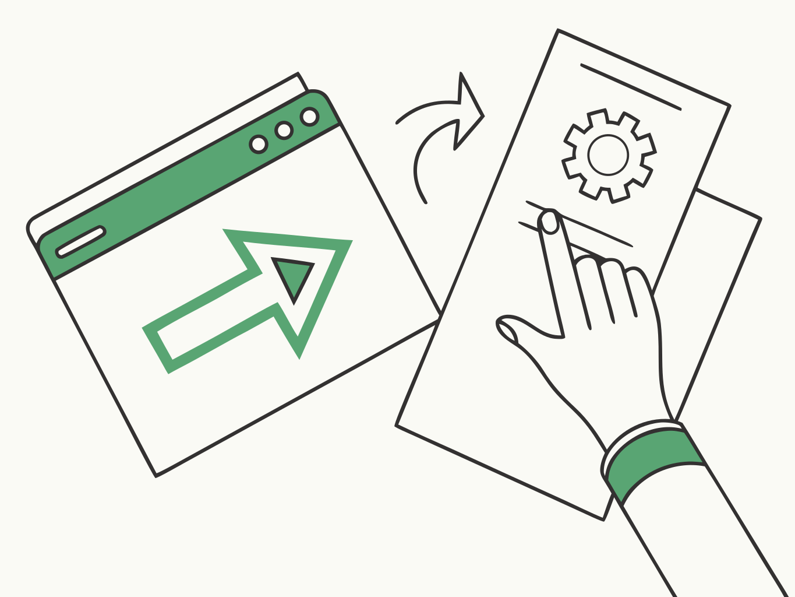
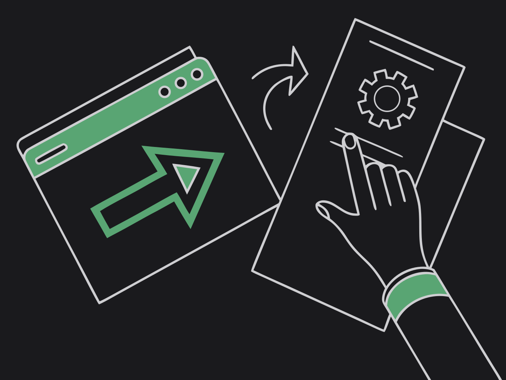

`button` and `link` elements emit `widget-action` events back to the app.

{class="dark:hidden"}
{class="hidden dark:block"}

```typescript
import { onWidgetAction } from "tauri-plugin-widgets-api";

await onWidgetAction((data) => {
  console.log("Action:", data.action, data.payload, data.widgetId, data.group);
});
```

Action payload shape: `{ action, payload?, ts, widgetId, group }`.

You can also emit from the host with `widgetAction(action, payload?)`.

## Local state (`state`, `set`)

A widget can change itself on tap without the app: check off a task, switch a tab, count.
`state` holds the defaults; `set` on a `button`, `toggle` or `link` changes them when tapped.
The renderer writes the new value right where the widget runs (a WidgetKit AppIntent, the
Android widget receiver, the desktop window) and redraws — the app does not have to run.

::demo-video{src="interactive-state" caption="Local state: taps check off tasks and count cups with no app code (desktop renderer)."}
::

```json
{
  "state": { "tab": "today", "done": false, "cups": 0 },
  "small": {
    "type": "vstack",
    "children": [
      { "type": "toggle", "label": "Done", "isOn": false,
        "bind": { "isOn": "state.done" }, "set": { "done": "$toggle" } },
      { "type": "button", "label": "{{state.cups}} cups", "set": { "cups": "$inc" } },
      { "type": "repeat", "each": "data.tabs", "as": "tab",
        "template": { "type": "button", "label": "{{tab.title}}", "set": { "tab": "{{tab.id}}" } } },
      { "type": "text", "content": "Today's list", "when": { "path": "state.tab", "eq": "today" } }
    ]
  }
}
```

`state` is a root like `data`: `{{state.key}}`, `when: { "path": "state.key" }`,
`bind: { "isOn": "state.done" }` (keeps the JSON type), `repeat.each: "state.list"`. Loop
variables and template arguments named `state` hide it. Values in `set`:

| Value | Writes |
| --- | --- |
| `"$toggle"` | the opposite boolean (missing → `true`) |
| `"$inc"` / `"$dec"` | the number plus / minus 1 (missing → 0 first) |
| `null` | removes the key, so the default shows again |
| anything else | that JSON value (strings may use placeholders: `"{{tab.id}}"`) |

The stored state is merged over `state` per top-level key: first the widget's
(`state:{widgetId}`), then the placement's own (`state:{widgetId}#{instance}`). A tap writes
the placement's own when the widget has an instance. If the element also has `action`, the
action goes to the app after the write.

From the app:

```ts
import { setWidgetState, getWidgetState } from "tauri-plugin-widgets-api";
import { listen } from "@tauri-apps/api/event";

await setWidgetState("tasks", { tab: "week", cups: "$inc" }); // same operators
const state = await getWidgetState("tasks");                    // defaults + stored
await listen("widget-state-changed", (e) => console.log(e.payload)); // { widgetId, instance, state }
```

`setWidgetState(widgetId, null)` clears the stored state. Taps made while the app is
running also send `widget-state-changed`.

| Platform | `set` tap |
| --- | --- |
| iOS 17+ / macOS 14+ | AppIntent in the extension writes the App Group store, WidgetKit redraws |
| Android | The widget's broadcast receiver writes the store and redraws |
| Desktop window | The window writes through the plugin and redraws every window of the widget |
| Windows Widgets Board | Shows the state; taps are not handled |

